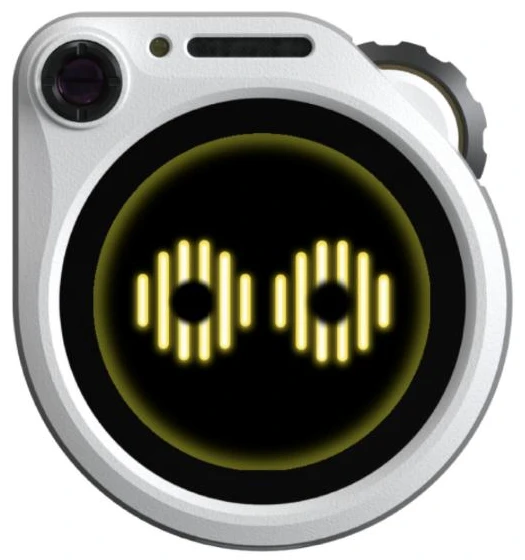

The SenseCAP Watcher is a palm-sized desk device from Seeed Studio with a 1.46 inch round touch display, a rotary
wheel, a microphone and speaker, a camera with a separate AI chip, a battery and a microSD slot. It is built around an
ESP32-S3 with 32 MB of flash and 8 MB of octal PSRAM. It ships with Seeed's own firmware, and flashing ESPHome over USB
is all that is needed.

- [Seeed SenseCAP Watcher W1-A](https://www.seeedstudio.com/SenseCAP-Watcher-W1-A-p-5979.html)
- [Seeed documentation](https://wiki.seeedstudio.com/getting_started_with_watcher/)

Note that the [Seeed SenseCAP Indicator](/devices/seeed-sensecap/) is a different device.

## Hardware

| Feature    | Details                                                                      |
| ---------- | ---------------------------------------------------------------------------- |
| SoC        | ESP32-S3, 32 MB flash, 8 MB octal PSRAM                                      |
| Display    | SPD2010, 412x412 round, QSPI (`mipi_spi` model `SEEED-SENSECAP-WATCHER`)     |
| Touch      | SPD2010 touch controller, I2C `0x53`, on its own bus                         |
| Audio      | ES8311 DAC and speaker amplifier, ES7243E ADC and microphone, shared I2S bus |
| Input      | Rotary wheel with push button                                                |
| AI camera  | Himax chip on its own SPI bus (not covered by the configurations below)      |
| RTC        | PCF8563 on the main I2C bus                                                  |
| Status LED | One WS2812 LED                                                               |
| Power      | Battery with charger, USB-C, switchable Grove port power                     |
| Storage    | microSD slot (shares the Himax SPI bus)                                      |
| Expansion  | Grove connector                                                              |

## Pins

### ESP32-S3

| Function              | Pin(s)                                                 |
| --------------------- | ------------------------------------------------------ |
| Main I2C              | SDA `GPIO47`, SCL `GPIO48`                             |
| Touch I2C             | SDA `GPIO39`, SCL `GPIO38`                             |
| Display SPI (quad)    | CLK `GPIO7`, data `GPIO9`, `GPIO1`, `GPIO14`, `GPIO13` |
| Display chip select   | `GPIO45` (strapping pin, handled by the model)         |
| Display reset         | None, software reset is used                           |
| Backlight             | `GPIO8`, active-high PWM                               |
| I2S                   | MCLK `GPIO10`, BCLK `GPIO11`, LRCLK `GPIO12`           |
| Microphone data in    | `GPIO15`                                               |
| Speaker data out      | `GPIO16`                                               |
| Rotary wheel          | A `GPIO41`, B `GPIO42`                                 |
| Status LED (WS2812)   | `GPIO40`                                               |
| Battery voltage (ADC) | `GPIO3` (strapping pin)                                |
| Himax AI chip SPI     | CLK `GPIO4`, MOSI `GPIO5`, MISO `GPIO6`, CS `GPIO21`   |
| microSD chip select   | `GPIO46` (strapping pin)                               |

### I/O expander

The power rails, the wheel button and the charger status are on a TCA9555 I/O expander (`tca9555`, address `0x21`,
main I2C bus).

| Expander pin | Function                                               | Direction |
| ------------ | ------------------------------------------------------ | --------- |
| 0            | Charging (high while charging, polarity not confirmed) | Input     |
| 1            | Charge complete (inverted)                             | Input     |
| 2            | USB power present (inverted)                           | Input     |
| 3            | Wheel push button (inverted)                           | Input     |
| 4            | microSD card inserted (inverted)                       | Input     |
| 6            | Himax data ready / sync                                | Input     |
| 7            | Himax reset                                            | Output    |
| 9            | Display panel power                                    | Output    |
| 10           | System power hold                                      | Output    |
| 11           | Himax power                                            | Output    |
| 12           | Speaker amplifier power                                | Output    |
| 13           | Battery present (inverted)                             | Input     |
| 14           | Grove port power                                       | Output    |
| 15           | Battery voltage divider enable                         | Output    |

The touch controller interrupt line is also on the expander, so the touchscreen is polled instead.

## Basic configuration

This is the hardware definition: the display, backlight, panel power and touch. Add your own `wifi`, `api` and `ota`
sections and any extras on top of it.

```yaml file=config.yaml
```

The configuration does not include `wifi` credentials, `api` or `ota` (these pages keep the device definition free of
network settings), so add them to your own copy.

Things to be aware of in this configuration:

- The panel power (expander pin 9) must be on before the display is set up. ESPHome sets up the expander first, then
  the GPIO switches, then the display and touchscreen, so the order in the file does not matter, but the switch must
  exist.
- The system power hold (expander pin 10) must stay on, otherwise the device switches off when running from the
  battery.
- The display chip select is `GPIO45`, a strapping pin. The `SEEED-SENSECAP-WATCHER` model already sets it up, you do
  not need to configure it or `ignore_strapping_warning`.
- There is no reset pin for the display, the panel is reset in software.
- The display is on the `spi3` host so that it does not depend on the order of the `spi:` entries if you also use the
  Himax or microSD bus.

## Voice assistant configuration

This configuration adds the audio hardware and a local wake word, and connects the device to the Home Assistant voice
assistant pipeline:

- ES8311 DAC and ES7243E ADC on a full duplex I2S bus.
- A mixing speaker with separate announcement and media streams, and a media player.
- `micro_wake_word` with the "Okay Nabu" model, and `voice_assistant`.
- A mute switch.
- The rotary wheel turns the volume up and down, and pressing it (or touching the screen) starts or stops the assistant.
- A single label on the display shows the assistant state.

```yaml file=voice-assistant.yaml
```

Things to be aware of in this configuration:

- The ES7243E ADC is at address `0x14`, not the default `0x10`.
- The microphone is wired to the right I2S channel.
- The speaker amplifier is powered from the expander (pin 12) and has to be switched on.
- Wake word detection is faster with the sdkconfig options in the example, which run code and read-only data from
  PSRAM.
- Other wake word models (`hey_jarvis`, `hey_mycroft`) can be added to `micro_wake_word`.
- The configuration is a starting point. The display only shows the assistant state, and timers are not handled on the
  screen.

Add your own `wifi` credentials and `api` encryption key before flashing, then adopt the device in Home Assistant and
choose a voice assistant for it in the device settings.

## First flash

1. Back up the factory firmware (see below). It is the only way to return to Seeed's firmware, and the flash holds
   per-device keys in the `nvsfactory` partition.
2. Connect the device to your computer with a USB-C cable.
3. Install ESPHome using the configuration above, either with `esphome run` or by building it and flashing with
   [ESPHome Web](https://web.esphome.io/) or `esptool`.
4. After this first flash, updates can be done over the air.

The USB-C port presents a USB serial bridge (a WCH CH342 dual serial adapter) with two ports. Which is which matters:

| Interface | Linux device (example) | Connected to                        |
| --------- | ---------------------- | ----------------------------------- |
| `if02`    | `/dev/ttyACM1`         | ESP32-S3: flashing and logs         |
| `if00`    | `/dev/ttyACM0`         | Himax AI chip console (921600 baud) |

The device names depend on what else is plugged in, so check `/dev/serial/by-id/` and pick the entry ending in
`-if02` for the ESP32-S3. Opening the Himax port resets the Himax chip, since its reset is wired to DTR/RTS.

## Backing up and restoring the factory firmware

The flash is 32 MB (`0x2000000` bytes). Use `esptool` at 460800 baud, 921600 baud fails on the USB bridge.

```bash
esptool --port /dev/ttyACM1 --baud 460800 read-flash 0 0x2000000 watcher-factory-esp32s3-32MB.bin
```

To go back to Seeed's firmware, write the whole image back at address 0:

```bash
esptool --port /dev/ttyACM1 --baud 460800 write-flash 0 watcher-factory-esp32s3-32MB.bin
```

The factory partition table has `nvsfactory` at `0x9000` (device keys), `nvs` at `0x3b000`, `otadata` at `0x10d000`,
`ota_0` at `0x110000`, `ota_1` at `0xd10000`, a `model` partition at `0x1910000` and `storage` at `0x1a10000`.

## Notes

- **Strapping pins:** `GPIO45` (display chip select), `GPIO46` (microSD chip select) and `GPIO3` (battery ADC) are
  ESP32-S3 strapping pins. `GPIO46` has a pull-down and should be driven high if you use the Himax bus, so the
  microSD card does not answer on it. The battery ADC pin needs `ignore_strapping_warning: true`.
- **Battery voltage:** enable the divider (expander pin 15) only while measuring, then read `GPIO3` with a 2.5 dB
  attenuation and multiply by 4.1 (62k and 20k divider).
- **Himax AI chip:** the camera and AI chip have their own SPI bus and are not covered by the configurations on this
  page. They need an external component that is not yet part of ESPHome.
