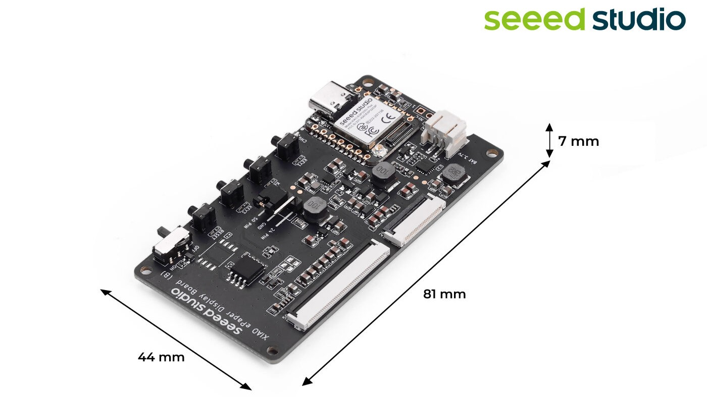
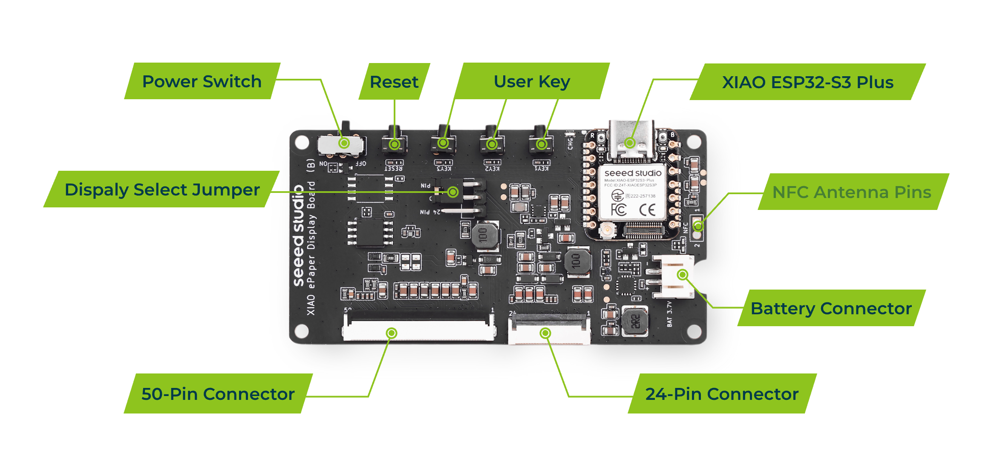

## Product Images





## Description

The Seeed Studio XIAO ePaper Driver Board EE04 is a carrier board built around a XIAO ESP32-S3 Plus
module. Two 0.5 mm FPC connectors (24-pin and 50-pin), selected with an onboard jumper, let it drive either
a 24-pin ePaper panel (1.54" to 7.5", monochrome or tri-color) or a 50-pin 7.3" Spectra6 panel. It also has
three programmable buttons, a JST 2.0 mm battery connector with a charging IC, and USB-C.

The configuration below wires up the fixed 24-pin SPI interface with the `waveshare_epaper` display
platform; change `model` to match whichever panel is attached. The 50-pin Spectra6 panel uses a different
display platform (`epaper_spi`) and isn't covered here.

## GPIO Pinout

| Pin    | Function                                                 |
| ------ | --------------------------------------------------------- |
| GPIO7  | ePaper SPI CLK                                            |
| GPIO9  | ePaper SPI MOSI                                           |
| GPIO44 | ePaper CS                                                 |
| GPIO10 | ePaper DC                                                 |
| GPIO4  | ePaper BUSY                                               |
| GPIO38 | ePaper RESET                                              |
| GPIO2  | KEY0 user button (active low)                             |
| GPIO3  | KEY1 user button (active low)                             |
| GPIO5  | KEY2 user button (active low)                             |
| GPIO1  | Battery voltage sense (A0)                                 |
| GPIO6  | Battery ADC enable (A5) — must be driven high before reading GPIO1 |

## Example Configuration

```yaml file=config.yaml
```
