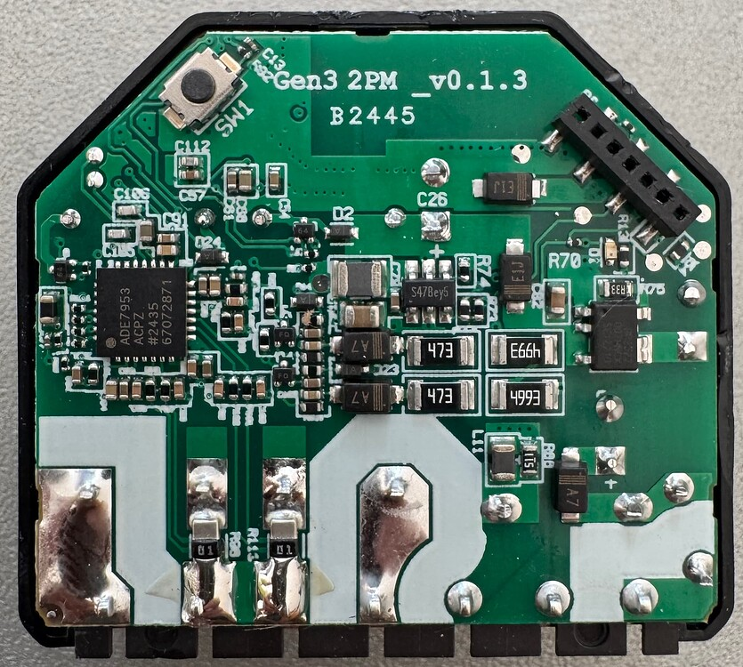

Product image: [Shelly 2PM Gen3](https://www.shelly.com/products/shelly-2pm-gen3).

Generation 3 of Shelly 2. With Powermeter. \
Generation 3 configurations are not compatible with earlier Shelly 2 generation hardware. \
General hardware info, including serial pinout is on the
[Shelly Knowledgebase](https://kb.shelly.cloud/knowledge-base/shelly-2pm-gen3).

## GPIO Pinout

| Pin    | Function     |
| ------ | ------------ |
| GPIO0  | ASE7953 RST  |
| GPIO1  | ADE7953 IRQ  |
| GPIO2  | LedLink_i    |
| GPIO3  | Relay 1      |
| GPIO4  | ADC Temp     |
| GPIO5  | Relay 2      |
| GPIO6  | I2C SDA      |
| GPIO7  | I2C SCL      |
| GPIO10 | Switch 1     |
| GPIO18 | Switch 2     |
| GPIO19 | Reset Button |



## Flashing

Shelly's own OTA updater will install ESPHome over the network: no case-opening, no UART.
[free-shelly-ota](https://github.com/oxynatOr/free-shelly-ota) builds and sends the package. Its
[2PM Gen3 page](https://github.com/oxynatOr/free-shelly-ota/blob/main/docs/devices/S2PMG3.md) lists the partition table
and `esp32:`/`ota:` settings your config needs before the tool will build it, and has a report of the tool converting
one from Shelly firmware 1.4.99. Two more units (`S3SW-002P16EU`) have been converted from Shelly firmware 2.0.1 with
scripts outside free-shelly-ota that build the same kind of package.

Flash a config that has your own `wifi:` credentials, `api:` and `ota:` (see Basic Configuration below): the update
wipes Shelly's Wi-Fi settings. Keep a serial adapter as your way back: once ESPHome's bootloader is on the device, only
serial gets you back to Shelly firmware (pinout on the Shelly Knowledgebase page above). Later updates go over
ESPHome's own OTA, same as any ESPHome device.

The older [mgos32-to-tasmota32](https://github.com/tasmota/mgos32-to-tasmota32) route is not an option here: that
project is archived, does not list the 2PM Gen3, and does not support Shelly firmware 1.5 or later.

## Basic Configuration

This will appear in Home Assistant as two relays linked to the switch inputs. This includes power and temperature
monitoring of the I2C interfaces. Add your own `api:` and `ota:` sections before flashing, and fill in `wifi:` with
your own network credentials — the example below leaves those out so it can be merged into your own setup.

Most of this configuration was taken from [this Home Assistant Community thread][1], and the work to figure out the GPIO
pins is thanks to [the Tasmota community.][2]

[1]: https://community.home-assistant.io/t/do-you-have-a-working-esphome-config-for-shelly-3gen-2pm/833575/3
[2]: https://github.com/arendst/Tasmota/discussions/22526#discussioncomment-11407244

```yaml file=config.yaml
```

Add a captive portal on top if you want one for initial WiFi setup — not required, just convenient:

```yaml file=captive-portal.yaml
```

The thermal cutoff in `config.yaml` turns both relays off above `max_temp`. To also get a Home Assistant notification
when it trips, add this (it needs `api:`):

```yaml file=overheat-notification.yaml
```
