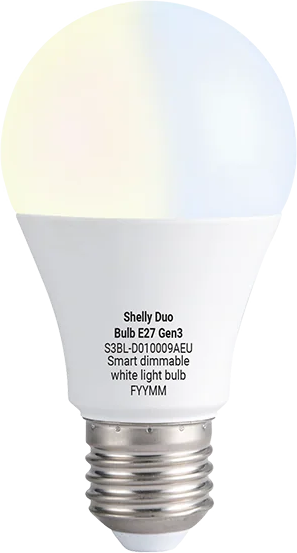

The Shelly Duo Bulb E27 Gen3 (`S3BL-D010009AEU`) is a Wi-Fi LED bulb with an E27 socket and tunable white (one warm
and one cold white channel). It is built around an `ESP-Shelly-C38F` module (ESP32-C3, 8 MB flash).



Both white channels are driven directly by PWM from two GPIOs, so ESPHome's `cwww` light works without an external
component.

Tested on a real bulb: flashing over UART and a normal ESPHome run with the configuration below. Not tested: OTA from
the Shelly firmware.

> **Warning:** The bulb contains a **non-isolated mains power supply**. Never open it or connect a serial adapter while
> it is connected to mains voltage.

## Flashing

### UART

Remove the frosted cover and the LED board to reach the driver PCB with the module. The pads on the edge of the module
are covered with sealant, which has to be removed carefully, and have to be soldered. Connect a 3.3 V USB-to-serial
adapter; the colour is the marker in the picture. Take the bulb out of the socket and power it only from the adapter.


| Function        | Colour |
| --------------- | ------ |
| TXD             | Blue   |
| RXD             | Green  |
| 3V3             | Red    |
| CHIP_PU         | Brown  |
| BOOT (GPIO9)    | Yellow |
| GND             | Black  |

TXD and RXD are named from the chip's point of view: connect TXD to RX and RXD to TX of the adapter. To enter download
mode, connect BOOT to GND while powering on and release it after the chip has started.

As always, first take a dump!

```bash
esptool --chip esp32c3 --port COM11 --baud 460800 read_flash 0x0 0x800000 shelly_duo_bulb_gen3.bin
```

Then flash the `firmware.factory.bin` of your build to `0x0`:

```bash
esptool --chip esp32c3 --port COM11 --baud 460800 write_flash 0x0 firmware.factory.bin
```

## GPIO Pinout

| Pin    | Function                                  |
| ------ | ----------------------------------------- |
| GPIO4  | Warm white (LEDC PWM, module pad `MTMS`)  |
| GPIO5  | Cold white (LEDC PWM, module pad `MTDI`)  |
| GPIO9  | BOOT (download mode, low-active)          |
| GPIO20 | UART RX (console, logger)                 |
| GPIO21 | UART TX (console, logger)                 |

## Configuration

`constant_brightness: true` keeps the brightness constant while the colour temperature changes. 2700 K and 6500 K are
the rated colour temperatures of the bulb. No energy meter chip is known, so the configuration has no power sensor.

```yaml file=config.yaml
```
