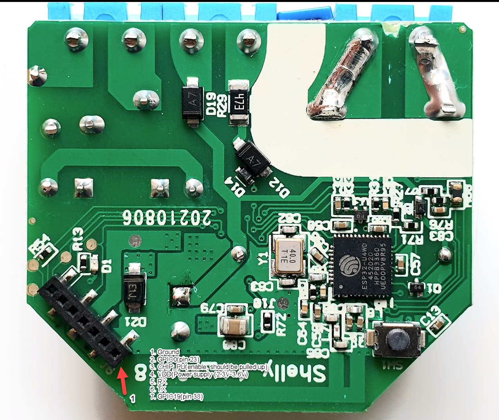

## GPIO Pinout

| Pin    | Function                                          |
| ------ | ------------------------------------------------- |
| GPIO0  | LED (Inverted), Shelly Plus Add-On: DATA (Output) |
| GPIO1  | Shelly Plus Add-On: DATA (Input)                  |
| GPIO3  | Shelly Plus Add-On: ANALOG IN                     |
| GPIO4  | Switch input                                      |
| GPIO19 | Shelly Plus Add-On: DIGITAL IN                    |
| GPIO25 | Button (Inverted, Pull-up)                        |
| GPIO26 | Relay                                             |
| GPIO32 | NTC                                               |
| GPIO33 | Relay supply voltage sensor                       |

The Shelly Plus 1 is based on the ESP32-U4WDH (Single core, 160MHz, 4MB embedded flash)

Please calibrate the NTC, the value below is just a rough estimate!

Credit and thanks to

- [https://templates.blakadder.com/shelly_plus_1.html](https://templates.blakadder.com/shelly_plus_1.html)

## Configuration as relay with overtemperature protection

```yaml file=config.yaml
```

