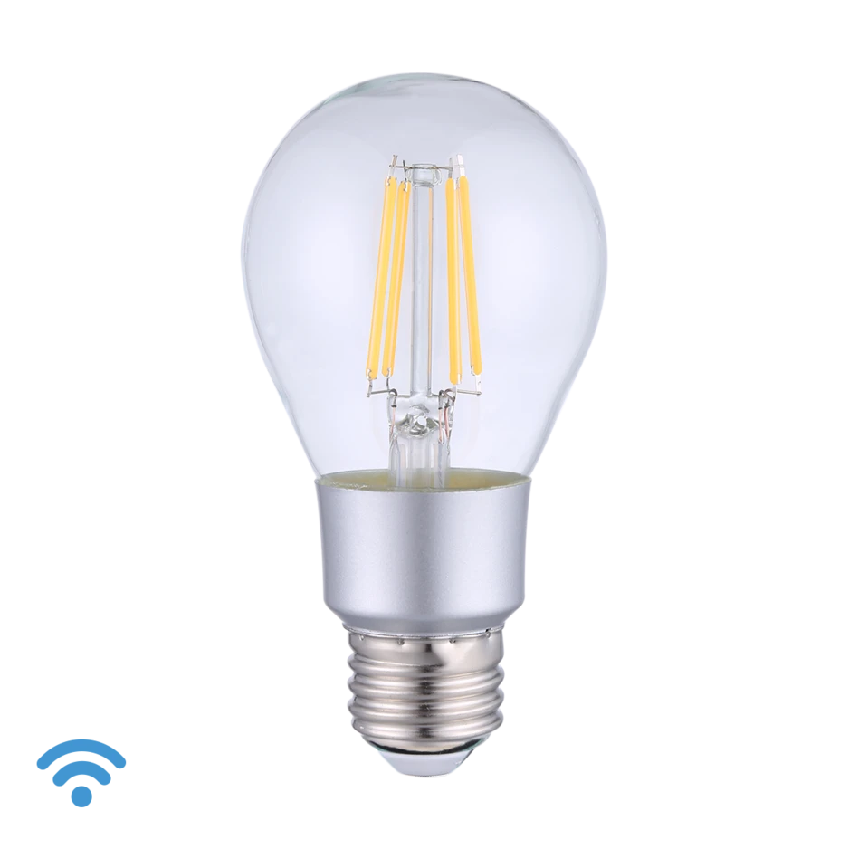

## Product Images



## GPIO Pinout

| Pin    | Function   |
| ------ | ---------- |
| GPIO04 | Brightness |

## Basic Configuration

```yaml
# Basic Config
---
substitutions:
  device_name: "shellyvintagea19"
  friendly_name: "Shelly Vintage A19"
  light_restore_mode: RESTORE_DEFAULT_ON

esphome:
  name: "${device_name}"
  name_add_mac_suffix: false

esp8266:
  board: esp01_1m
  restore_from_flash: true

preferences:
  flash_write_interval: 1min
    
# OTA flashing
ota:
  - platform: esphome

wifi: # Your Wifi network details
  
# Enable fallback hotspot in case wifi connection fails  
  ap:

# Enabling the logging component
logger:
  baud_rate: 0

# Enable Home Assistant API
api:

# Enable the captive portal
captive_portal:

mdns:
  disabled: false

# Enable the Web Server component 
webserver:

text_sensor:
  - platform: wifi_info
    ip_address:
      name: "${friendly_name} IP Address"
      disabled_by_default: false
    mac_address:
      name: "${friendly_name} MAC Address"
      disabled_by_default: false

output:
  - platform: esp8266_pwm
    id: brightness
    pin: GPIO4

light:
  - platform: monochromatic
    name: "${friendly_name} Light"
    output: brightness
```
