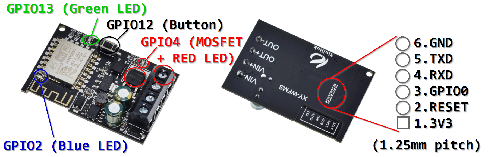

This device can be found on [AliExpress](https://www.aliexpress.com/wholesale?SearchText=Sinilink+XY-WFF)
for about 5 USD.

## Flashing



Can be tricky to solder the ground connection to the PCB due to heavy ground plane, I used P50 pogo pins in a printed
adapter for 6x1.25mm but the Vin- screw terminal could also be used for conveient ground connection.

## GPIO Pinout

| Pin    | Function          |
| ------ | ----------------- |
| GPIO02 | Blue LED          |
| GPIO04 | Relay and Red LED |
| GPIO12 | Toggle Button     |
| GPIO13 | Green LED         |

## Basic Config

The following configuration is adapted from the [Sinilink XY-WFUSB USB Switch Relay][1] device page with only minor
changes to fit the new device.

[1]: /devices/Sinilink-XY-WFUSB-USB-Switch-Relay/

There is a 3D printable case available from
[https://www.thingiverse.com/thing:4146127](https://www.thingiverse.com/thing:4146127)

```yaml
substitutions:
  devicename: xy_wfms
  upper_devicename: "Sinilink XY-WFMS ESP8266 Wifi Mosefet"

esphome:
  name: $devicename

esp8266:
  board: esp01_1m
captive_portal:

ESP8266:
  board: esp01_1m
    
# OTA flashing
ota:
  - platform: esphome

wifi: # Your Wifi network details
  
# Enable fallback hotspot in case wifi connection fails  
  ap:

# Enabling the logging component
logger:

# Enable Home Assistant API
api:

# Enable the captive portal
captive_portal:

# Enable the Web Server component 
webserver:

status_led:
  pin:
    number: GPIO2 # blue led
    inverted: true #off when ok

switch:
  # Relay (has red led hardwired; relay on = led on)
  - platform: gpio
    id: relay
    pin: GPIO4
    restore_mode: RESTORE_DEFAULT_OFF

  # green led
  - platform: gpio
    pin: GPIO13
    id: green_led
    inverted: false
    restore_mode: RESTORE_DEFAULT_ON

  #  # blue led (if _not_ used for status led)
  #  - platform: gpio
  #    pin: GPIO2
  #    id: blue_led
  #    inverted: true
  #    restore_mode: RESTORE_DEFAULT_OFF

  # Switch template to link relay and green led states
  # green led is on when relay is off
  - platform: template
    id: "${devicename}_relay"
    name: $upper_devicename
    lambda: |-
      if (id(relay).state) {
        return true;
      } else {
        return false;
      }
    turn_on_action:
      - switch.turn_off:
          id: green_led
      - switch.turn_on: #also turns red led on
          id: relay
    turn_off_action:
      - switch.turn_on:
          id: green_led
      - switch.turn_off: #also turns red led off
          id: relay

# Button
binary_sensor:
  - platform: gpio
    id: button
    pin:
      number: GPIO12
      mode: INPUT_PULLUP
      inverted: True
    on_press:
      - switch.toggle: "${devicename}_relay"
```
