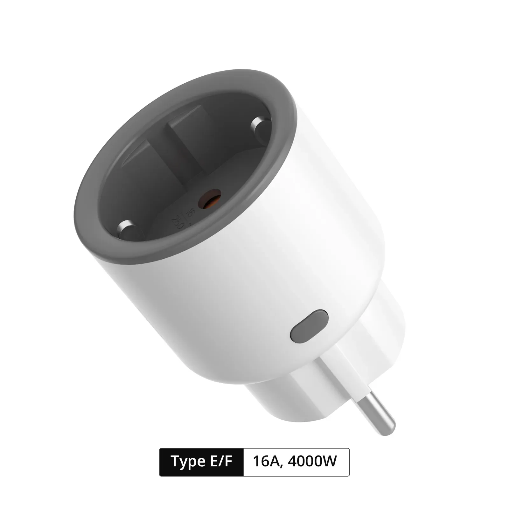

## GPIO Pinout

| Pin   | Function                           |
| ----- | ---------------------------------- |
| GPIO9 | Push Button (HIGH = off, LOW = on) |
| GPIO4 | Relay and its status red LED       |
| GPIO5 | Status LED                         |
| GPIO7 | TX pin (CSE7759B meter)            |

## Notes

Can be flashed wirelessly without disassembly using [Firmware Liberator](https://github.com/adamsthws/firmware-liberator)

## Links

- [Product Page](https://itead.cc/product/sonoff-iplug-wi-fi-smart-plug-s60/)
- [Sonoff S60 version Europe : tasmotized](https://github.com/arendst/Tasmota/discussions/21255)
- [Firmware Liberator](https://github.com/adamsthws/firmware-liberator)

## Basic Configuration

```yaml file=config.yaml
```
