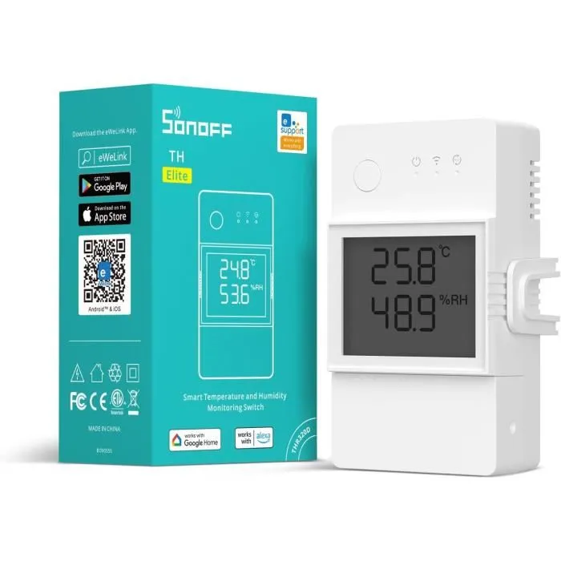

Sonoff THR316D is a part of
[Sonoff TH Elite](https://sonoff.tech/en-eu/products/sonoff-th-elite-smart-temperature-and-humidity-monitoring-switch)
series, along with [THR320D](../Sonoff-THR320D).
For the purposes of ESPHome, these devices are likely identical, and both are likely very similar to the TH Origin line
([THR316](../Sonoff-THR316) and THR320), except TH Origin not having LED screens or Dry contact pins.
It's quite possible that all four of these devices could share a single YAML configuration template.

## Initial flashing

**Do not connect the relay to mains power while flashing!**
To enter flashing mode, remove the back cover by unscrewing all four screws at the back, connect your USB-UART cable
to the J7 programming header on the board, then connect the USB end of the cable to your computer,
**while holding the button on the front side of the relay pressed**.

## GPIO pinout

| Pin    | Function                                        |
| ------ | ----------------------------------------------- |
| GPIO0  | Push Button (HIGH = off, LOW = on)              |
| GPIO5  | Display (TM1621) Data                           |
| GPIO13 | Right LED (Green/Auto)                          |
| GPIO15 | Middle LED (Blue/WiFi)                          |
| GPIO16 | Left LED (Red/Relay)                            |
| GPIO17 | Display (TM1621) CS                             |
| GPIO18 | Display (TM1621) Write                          |
| GPIO21 | Relay                                           |
| GPIO23 | Display (TM1621) Read                           |
| GPIO25 | Pin 2 of the RJ-9 connector                     |
| GPIO27 | Pin 1 of the RJ-9 connector                     |

## RJ9 pinout

RJ9 pins, when the connector is viewed from the contacts side, cables exiting at the bottom, and pin 1 is farthest left.

| Pin | Function               |
| --- | ---------------------- |
| 1   | Sensor 3.3V Power      |
| 2   | Sensor Bus Data In/Out |
| 3   | Not Connected          |
| 4   | Sensor Ground          |

## Dry Contact pinout

The Dry contact pins, when looking at the front of the device, with the Dry Contact connector being on top right.
Pin 1 is farthest left (closest to the RJ9 connector).

| Pin | Function |
| --- | -------- |
| 1   | COM      |
| 2   | NC       |
| 3   | NO       |

## Basic configuration with a Sonoff THS01 temperature and humidity sensor connected

An example config is shown below.
However, to make most use of your relay, you will most likely want to connect it to Wi-Fi and enable its API.
You might also want to enable OTA updates for easier flashing in the future.
The relevant sections have been commented out in this example.
Be sure to check them out and learn how to configure these components.

LED meaning:

- Left LED (Red): Lit when relay is on (electricity passes through to Line Out)
- Middle LED (Blue): Lit when Wi-Fi is connected
- Right LED (Green): Lit when climate control (Auto mode) is enabled

Button usage:

- Single press: turn the relay on or off
- Double press: turn climate control (Auto mode) on or off

In Auto mode, the relay will turn on automatically when ambient temperature either **falls below**
the specified threshold ("Heat", this is the default) or **rises above** it ("Cool").
Double-clicking the button will toggle between "Off" and the last active Auto mode.

Note that the functionality of Dry contact pins hasn't been tested with this configuration.

```yaml file=config.yaml
```
