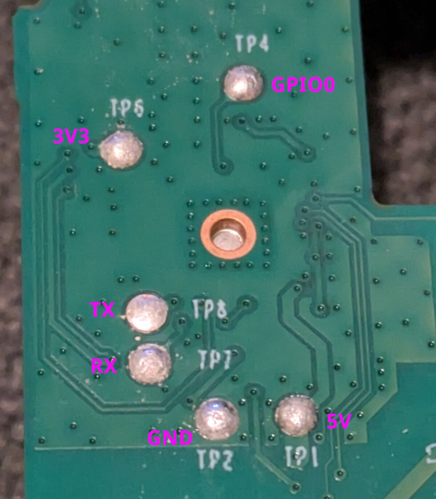

[TP-Link Tapo P100](https://www.tapo.com/en/product/tapo-p100-smart-plug/v1/1-pack)
is a simple smart plug, without power monitoring.


## GPIO Pinout

| Pin  | Function                   |
|------|----------------------------|
| PA17 | Push Button                |
| PA08 | Relay                      |
| PA09 | Orange LED                 |
| PA10 | Green LED                  |

Note that the Orange and Green LEDs are actually a single bi-colour LED,
which lights Orange when PA10 is low and PA9 is high, and Green
when PA10 is high, and PA9 is low. No light is emitted if both GPIOs
are the same level.

This pinout is identical for both the EU and UK variants.

## Test Pads and Flashing

The EU variant has labelled test pads on the top layer of the PCB, and there is no need to remove the PCB from the
housing.

The UK variant has test pads on the bottom layer of the PCB.
The mains prongs must be desoldered, allowing the PCB to be removed from the housing to access the underside.
The board and prongs have a lot of thermal mass, so you'll need a decent soldering iron.



> **Note:** I can't remember if TX/RX are swapped here or not. Try swapping if it doesn't work!

For both variants, GPIO0 must be pulled to 3.3V to enter flashing mode. The UART logic levels are also 3.3V.

During flashing, you can power the board on either the 3.3V rail or the 5V rail.
**DO NOT** flash while the board is connected to mains power.

## Basic Configuration

```yaml file=config.yaml
```

## Advanced Configuration

In order to properly support the bi-colour LED, some lambda magic can
be employed. The problem is that if the Green LED is used to indicate
relay state, and the Status LED flashes, the result is that the Green LED
flashes off and on, rather than any Orange LED being visible. The approach
taken is to use a template output as an intermediary for the status output,
as this is the only way to add a trigger/lambda.

This results in the Orange LED taking priority over the Green LED, and
being visibly Orange when active.

```yaml inline
output:
# The orange LED can be used as a status LED at the same time
# as the green LED is used to indicate the state of the relay
# by turning off the green output whenever the status output
# turns on. Unfortunately, the only way to add a trigger to an
# output is via a template output's write_action, so this is
# what we do.

  - platform: gpio
    id: internal_output_orange_led
    pin: PA9

  - platform: template
    id: output_orange_led
    type: binary
    write_action:
      - lambda: |-
          bool green = id(green_led)->current_values.is_on();
          if (green) green ^= state;
          id(output_green_led)->set_state(green);
          id(internal_output_orange_led)->set_state(state);
```
