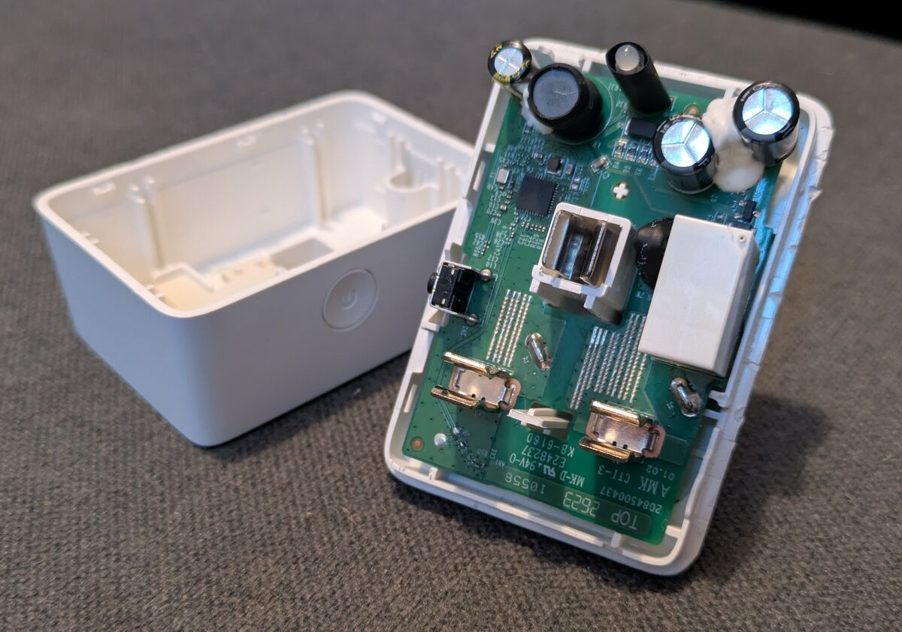
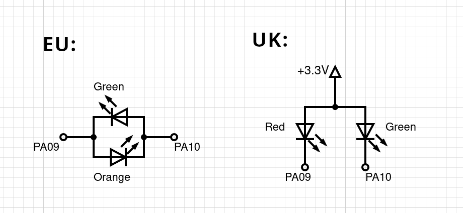

[TP-Link Tapo P100](https://www.tapo.com/en/product/tapo-p100-smart-plug/v1/1-pack)
is a simple smart plug, without power monitoring.



## GPIO Pinout

| Pin  | EU                                   | UK                |
| ---- | ------------------------------------ | ----------------- |
| PA17 | Push Button                          | Push Button       |
| PA08 | Relay                                | Relay             |
| PA09 | Orange LED Anode, Green LED Cathode  | Red LED Cathode   |
| PA10 | Green LED Anode, Orange LED Cathode  | Green LED Cathode |

The EU variant has a 2-pin *orange*/green bi-colour LED, whereas the UK variant has a 3-pin *red*/green bi-colour LED:



## Test Pads and Flashing

The EU variant has labelled test pads on the top layer of the PCB, and there is no need to remove the PCB from the
housing.

The UK variant has test pads on the bottom layer of the PCB.
The mains prongs must be desoldered, allowing the PCB to be removed from the housing to access the underside.
The board and prongs have a lot of thermal mass, so you'll need a decent soldering iron.


> **Note:** I can't remember if TX/RX are swapped here or not. Try swapping if it doesn't work!

For both variants, GPIO0 must be pulled to 3.3V to enter flashing mode. The UART logic levels are also 3.3V.

During flashing, you can power the board on either the 3.3V rail or the 5V rail.
**DO NOT** flash while the board is connected to mains power.

## Basic Configuration

```yaml file=config.yaml
```

This configuration is compatible with both EU and UK models, although the LED will behave counterintuitively on the EU model
(see Advanced Configuration for a fix):

- For the UK version, status=red, relay-on=green, and both at the same time produces orange.
- For the EU version, status=green, relay-on=orange, and both at the same time will turn the LED **off**.

## Advanced Configuration (EU only)

Firstly, we re-define the LED GPIOs so that status is orange and relay is green.
The remaining problem is that if the Green LED is used to indicate
relay state, and the Status LED flashes, the result is that the Green LED
flashes off and on, rather than any Orange LED being visible. The approach
taken is to use a template output as an intermediary for the status output,
as this is the only way to add a trigger/lambda.

This results in the Orange LED taking priority over the Green LED, and
being visibly Orange when active.

```yaml file=advanced-configuration.yaml
```
