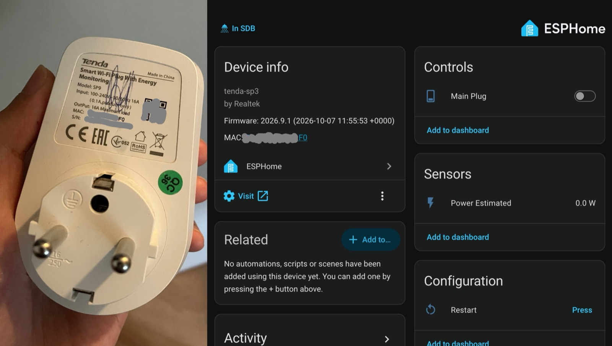

## Overview

The Tenda Beli SP9 is a smart plug with a relay, a physical button, a two-colour status LED and a power measurement
output. It is built around a Realtek RTL8710BX with 1 MiB of flash. It is sold in several regions with different plug
types; the circuit is the same, only the physical plug assembly differs.

The plug can be converted to ESPHome **over Wi-Fi, without opening it**, using
[convert-tenda-beli-to-esphome](https://github.com/ngxson/convert-tenda-beli-to-esphome). The tool runs a local proxy
that answers the stock cloud updater and sends it an ESPHome image instead of a Tenda one.

Tested on the EU variant: SP9 V1.0, RTL8710BX, 1 MiB flash, stock firmware `V1.1.0.17(139)_SP9_EU`. Other hardware
and firmware versions are unverified.

## Flashing

You need Python 3.10+, Docker, and a computer on the same 2.4 GHz LAN as the plug with internet access. Set the plug
up with the Beli app first, and write down its IP, serial number and MAC address.

1. Build the firmware with the repository's `esphome/build.sh`. It pins the ESPHome version, installs the custom
   board definition and prepares the image for the stock updater.
2. Start the proxy on your computer and allow TCP ports **1821**, **11812** and **11813** from the plug.
3. Point the plug at the proxy with `mitm/repoint.py`, wait for the proxy to report `serial_verified: True`, then
   push the image once.
4. Wait for the plug to reboot into ESPHome, then add it to Home Assistant through the ESPHome integration.

Follow the [README](https://github.com/ngxson/convert-tenda-beli-to-esphome#readme) for the exact commands. The
[maintainer guide](https://github.com/ngxson/convert-tenda-beli-to-esphome/blob/main/AGENTS.md) covers recovery,
future OTA updates, and power calibration.

Use an empty outlet and keep the plug powered during the transfer. A failed flash may need physical recovery over
UART. Once ESPHome is running, update it with regular ESPHome OTA and do not send another stock push.

## Board definition

The flash layout (two 468 KiB application slots in 1 MiB) does not match any stock LibreTiny board, so the
configuration uses the custom `tenda-sp3` board from
[boards/tenda-sp3.json](https://github.com/ngxson/convert-tenda-beli-to-esphome/blob/main/boards/tenda-sp3.json).
The file name is historical; it was tested with the SP9. Copy it into
`~/.platformio/platforms/libretiny/boards/` before compiling, or use the repository's build script, which does this
for you. Do not substitute a generic 2 MiB or 4 MiB board.

## GPIO Pinout

| Pin           | Function                                 |
| ------------- | ---------------------------------------- |
| PA12 / GPIO12 | Relay (active high)                      |
| PA11 / GPIO11 | Button (active low)                      |
| PA18 / GPIO18 | Load-correlated pulses for power reading |
| PA22 / GPIO22 | Blue LED (active low)                    |
| PA19 / GPIO19 | Yellow LED (active low)                  |

Do not sweep all pins as outputs to probe the board. An earlier all-pins test boot-looped the plug.

## Basic Configuration

Add your own `wifi:`, `api:` and `ota:` settings. The relay always starts OFF after a reboot, and the button toggles
it locally.

```yaml file=config.yaml
```

## Status LED

This fragment drives the LED from the connection state. Merge it into your config: it adds IDs to your `wifi:` and
`api:` blocks, and disables the API reboot timeout so the plug keeps working while Home Assistant is down.

| Connection status                            | Outlet ON      | Outlet OFF        |
| -------------------------------------------- | -------------- | ----------------- |
| Wi-Fi disconnected or still connecting       | Solid white    | Blinking white    |
| Wi-Fi connected, Home Assistant disconnected | Solid yellow   | Blinking yellow   |
| Home Assistant connected                     | Solid blue     | Off               |

"White" means both LED channels on together.

```yaml file=advanced.yaml
```

## Power Calibration

**Power Estimated** is a single-point estimate from one unit, calibrated against a 4.1 W lamp. The meter chip and
accuracy at other loads are unknown, and voltage, current and energy are not available.

To calibrate your plug, measure a steady load with a reference meter, then update the `multiply` filter:

`new_multiplier = old_multiplier * reference_watts / displayed_watts`

Check the result with a second load, and confirm it reads 0 W with the outlet OFF.
