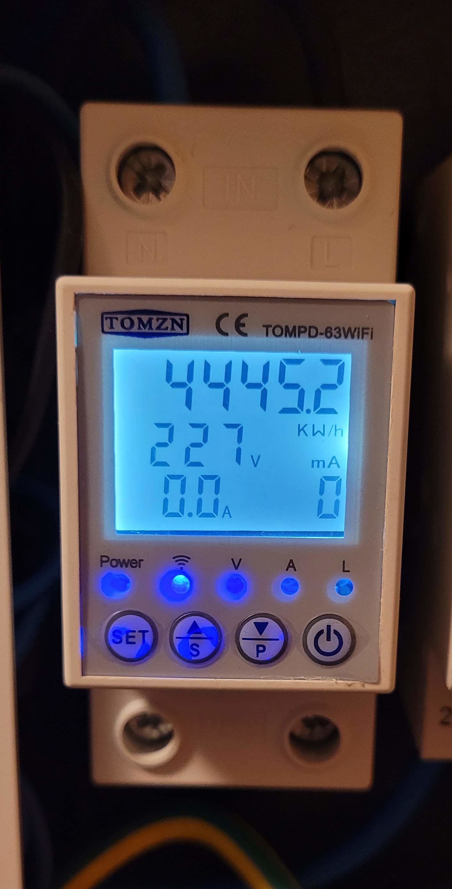
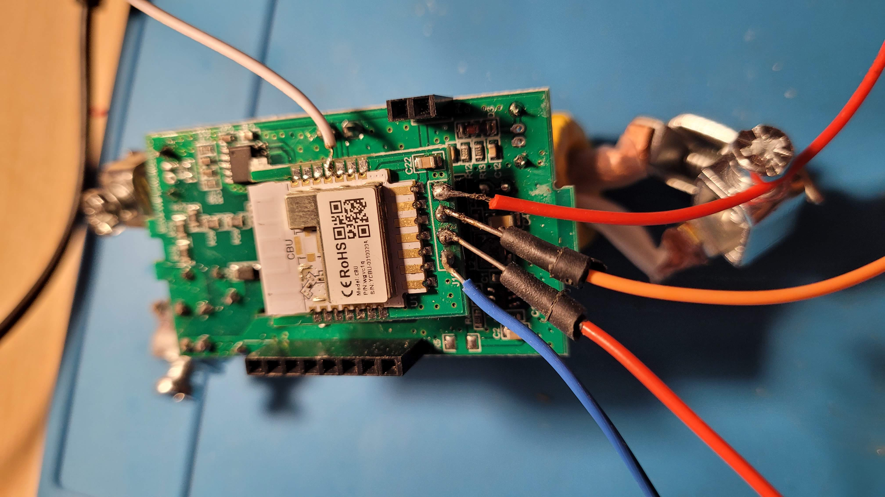

## Programming

Internally, it uses the [TUYA CBU](https://developer.tuya.com/en/docs/iot/cbu-module-datasheet?id=Ka07pykl5dk4u) chip,
which is based on the BK7231N.

You need to solder 5 wires for the GND, +3v3, RX, TX and CEN (Reset) signals in order to connect them to a USB-to-serial
(TTL) adapter.



Of course you also need USB-to-serial converter, and +3v3 supply (I'm using power out on my USB-to-serial converter),

You can flash the device using [ltchiptool](https://docs.libretiny.eu/docs/flashing/tools/ltchiptool/) or directly with
`esphome upload <your-config.yaml>` command from the console or ESPHome web GUI

If flashing fails, desoldering the CBU chip may help by improving 3.3V line stability.

## Dataponts

```text
[01:21:47][C][tuya:041]: Tuya:
[01:21:47][C][tuya:058]:   Datapoint 1: int value (value: 438)
[01:21:47][C][tuya:056]:   Datapoint 11: switch (value: OFF)
[01:21:47][C][tuya:058]:   Datapoint 13: int value (value: 0)
[01:21:47][C][tuya:054]:   Datapoint 6: raw (value: 09.0A.00.0F.FA.00.03.59 (8))
[01:21:47][C][tuya:060]:   Datapoint 19: string value (value: \x0E)
[01:21:47][C][tuya:056]:   Datapoint 12: switch (value: OFF)
[01:21:47][C][tuya:056]:   Datapoint 16: switch (value: ON)
[01:21:47][C][tuya:058]:   Datapoint 15: int value (value: 18)
[01:21:47][C][tuya:058]:   Datapoint 101: int value (value: 230)
[01:21:47][C][tuya:064]:   Datapoint 9: bitmask (value: 0)
[01:21:47][C][tuya:054]:   Datapoint 17: raw (value: 03.01.00.0D.04.00.00.00 (8))
[01:21:47][C][tuya:054]:   Datapoint 18: raw (value: 01.01.00.1E.03.01.00.FF.04.01.00.C8 (12))
[01:21:47][C][tuya:074]:   Product: '{"p":"hiow4txw9gjrys7w","v":"1.0.0","m":0}
```

## Basic ESPHome config

```yaml file=config.yaml
```

### Power measurements

Merge this optional fragment with `config.yaml` to decode datapoint 6 into voltage, current and power sensors.

```yaml file=power-measurements.yaml
```
