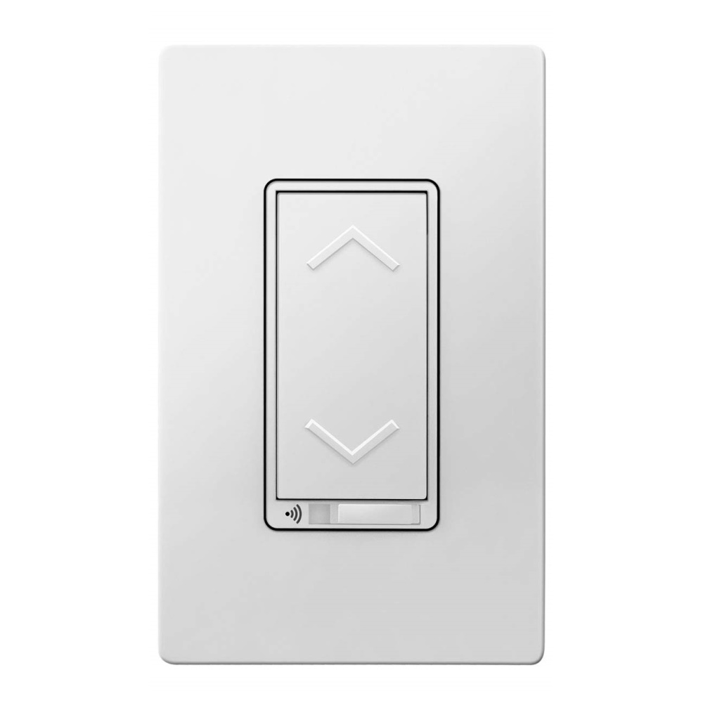

TOPGREENER TGWF500D 3-Way Smart Dimmer Switch

[Amazon Link](https://www.amazon.com/dp/B07BSX9SDF)

## Notes

This TuyaMCU requires a baud rate of 9600.

## GPIO Pinout

| Pin   | Function |
| ----- | -------- |
| GPI15 | Tuya Tx  |
| GPI15 | Tuya Rx  |

## Basic Configuration

```yaml
substitutions:
  device_name: familyroom_light_1 #change
  friendly_name: Family Room Light #change
  icon: "mdi:light-switch"

esphome:
  name: ${device_name}
  name_add_mac_suffix: true

esp8266:
  board: esp01_1m

wifi:
  ssid: !secret wifi_ssid
  password: !secret wifi_password
  fast_connect: true
  ap:
    ssid: ${device_name}
    password: !secret esphome_ap_password

wifi: # Your Wifi network details
  
# Enable fallback hotspot in case wifi connection fails  
  ap:

# Enabling the logging component
logger:
  level: DEBUG
  baud_rate: 0

# Enable Home Assistant API
api:

# Enable the captive portal
captive_portal:

# Enable the Web Server component 
webserver:

uart:
  rx_pin: GPIO13
  tx_pin: GPIO15
  baud_rate: 9600

tuya:

sensor:

  - platform: uptime
    name: ${friendly_name} Uptime

light:
  - platform: "tuya"
    name: ${friendly_name}
    dimmer_datapoint: 3
    switch_datapoint: 1
    min_value: 10
    max_value: 255
```
