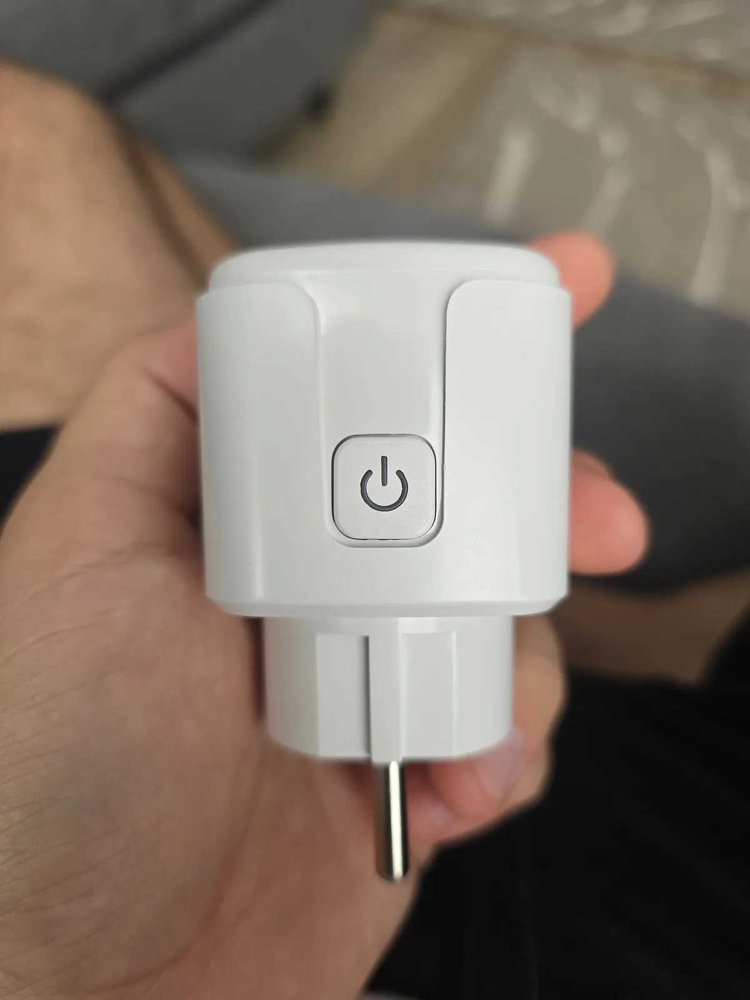
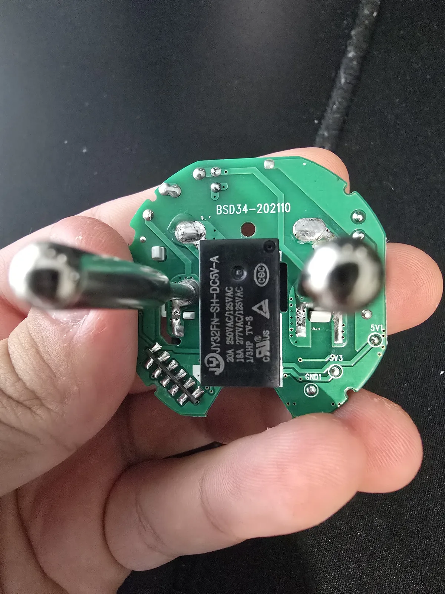
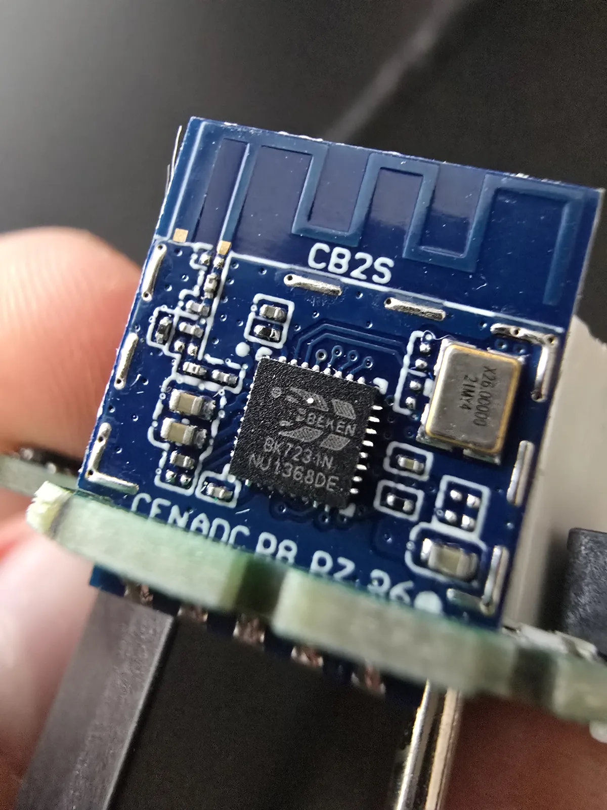
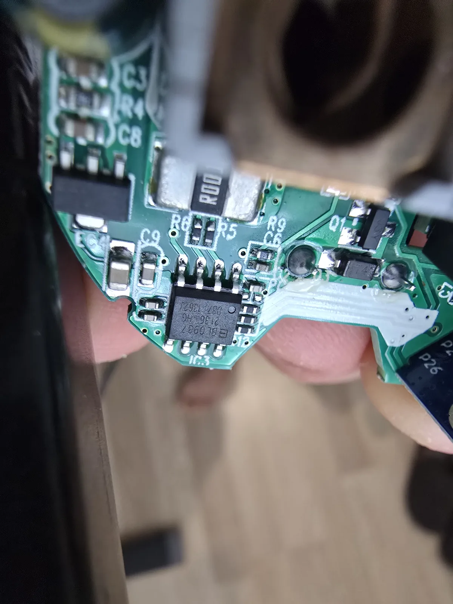

The Tuya BSD34 (often labeled `BSD34-202110` on the PCB, and sold under various brandings such as Elivco
or generic 16A/20A EU smart plugs on AliExpress) is a Wi-Fi smart plug with real-time power monitoring.

It features a Tuya **CB2S** module powered by the Beken **BK7231N** microcontroller and a Shanghai Belling
**BL0937** energy metering IC with a 1 mΩ (`R001`) shunt resistor.



## Warnings & Mains Safety

**Never** connect the plug to mains AC power while it is open or while serial flashing wires are attached.
Always power the device solely from the 3.3V supply of your USB-to-UART adapter during flashing. Reassemble
the enclosure completely before plugging into mains power.

## Disassembly & Internal Hardware

The plug enclosure is factory pressed together. Opening it exposes the main PCB labeled `BSD34-202110`,
housing the mains relay, high-voltage AC traces, BP2525 step-down power circuit, and daughterboard module.



### CB2S Wi-Fi Module

The board hosts a vertical Tuya CB2S daughterboard module based on the Beken BK7231N SoC.



### BL0937 Power Metering

Energy monitoring is handled by a Shanghai Belling BL0937 IC paired with an SMD `R001` (0.001 Ω / 1 mΩ) shunt
resistor located near the relay and load path.



## Flashing

The stock Tuya firmware cannot be flashed over-the-air via tuya-convert (patched firmware). Flashing ESPHome
requires a 3.3V USB-to-UART serial connection to the CB2S module pads.

For the CB2S module pinout and pad diagram, refer to the [LibreTiny CB2S documentation](https://docs.libretiny.eu/boards/cb2s/):

")

*(Source: [LibreTiny](https://docs.libretiny.eu/boards/cb2s/))*

### Flashing Steps

1. Open the outer plastic casing to expose the internal PCB and CB2S module.
2. Connect your 3.3V USB-to-UART adapter to the CB2S pads (see pinout diagram above):
   - `3V3` -> 3.3V (do not use 5V)
   - `GND` -> GND
   - `RX1` -> Adapter TX
   - `TX1` -> Adapter RX
3. Ground the `CEN` pin to `GND` to place the BK7231N into bootloader download mode.
4. Start flashing using [`ltchiptool`](https://docs.libretiny.eu/):

   ```bash
   ltchiptool flash write -d /dev/ttyUSB0 -b 115200 firmware.uf2
   ```

5. Release the `CEN` pin as `ltchiptool` starts negotiating the connection.
6. Once flashing succeeds, disconnect all programming wires and reassemble the casing before connecting to mains.

## GPIO Pinout

| Pin | Function | Notes |
| --- | --- | --- |
| `P6` | BL0937 CF1 | Voltage / Current pulse output (`inverted: true`) |
| `P7` | BL0937 CF | Active power pulse output (`inverted: true`) |
| `P8` | Status LED | Active low (`inverted: true`) |
| `P10` | Push Button | Active low (`INPUT_PULLUP`, `inverted: true`) |
| `P24` | BL0937 SEL | Mode select (`inverted: true`, high = voltage mode) |
| `P26` | Relay | Active high (`restore_mode: ALWAYS_OFF` recommended) |

## Power Monitoring Notes

- **Pulse Inversion:** The BK7231N interrupt driver requires `inverted: true` on `cf_pin` and `cf1_pin`
  to correctly detect the short pulses from the BL0937. Without inversion, readings remain at zero.
- **Current Resistor:** Set `current_resistor: 0.001` (the on-board shunt is 1 mΩ, labeled `R001`).
- **Voltage Divider:** The default `voltage_divider: 760` is a nominal starting value and may need calibration
  on your specific unit with a known reference load or multimeter.

## Basic Configuration

The hardware-only configuration below defines the Tuya CB2S (BK7231N) board, status LED, relay, button,
and BL0937 power monitoring sensors. Add your own `wifi:`, `api:`, and `ota:` credentials before compiling.
The source configuration is located in [`config.yaml`](config.yaml).

```yaml file=config.yaml
```
