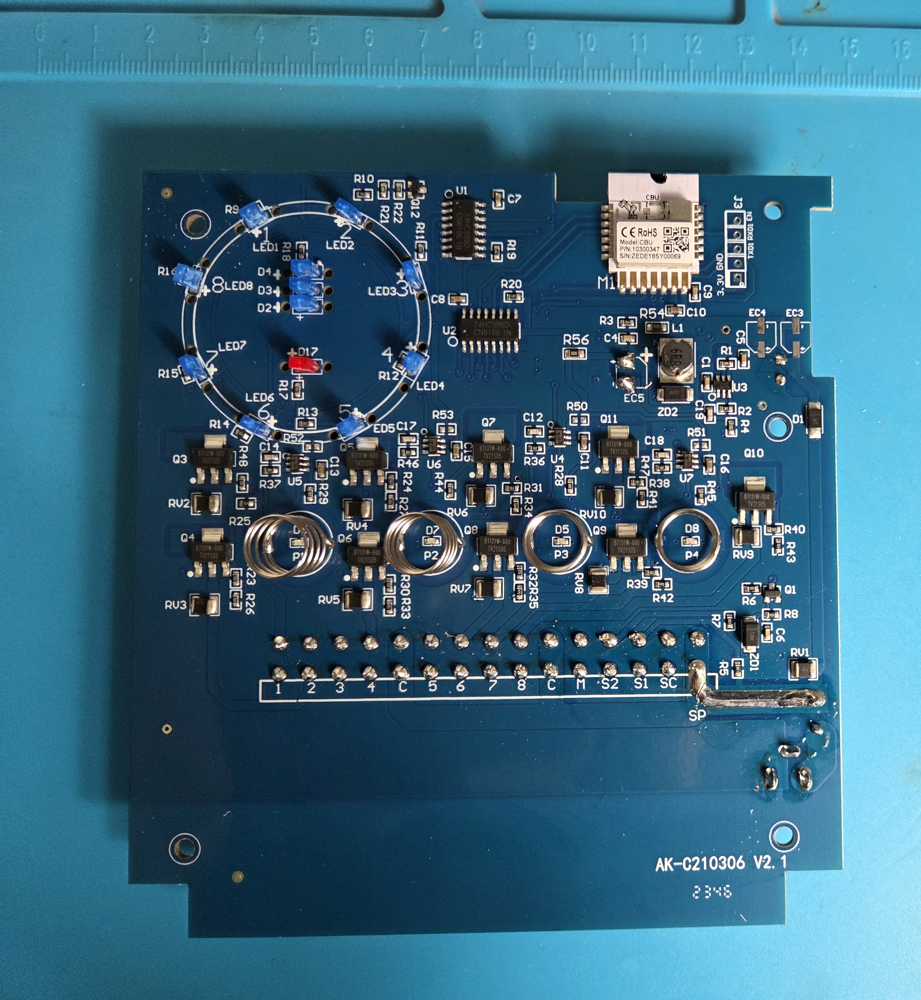
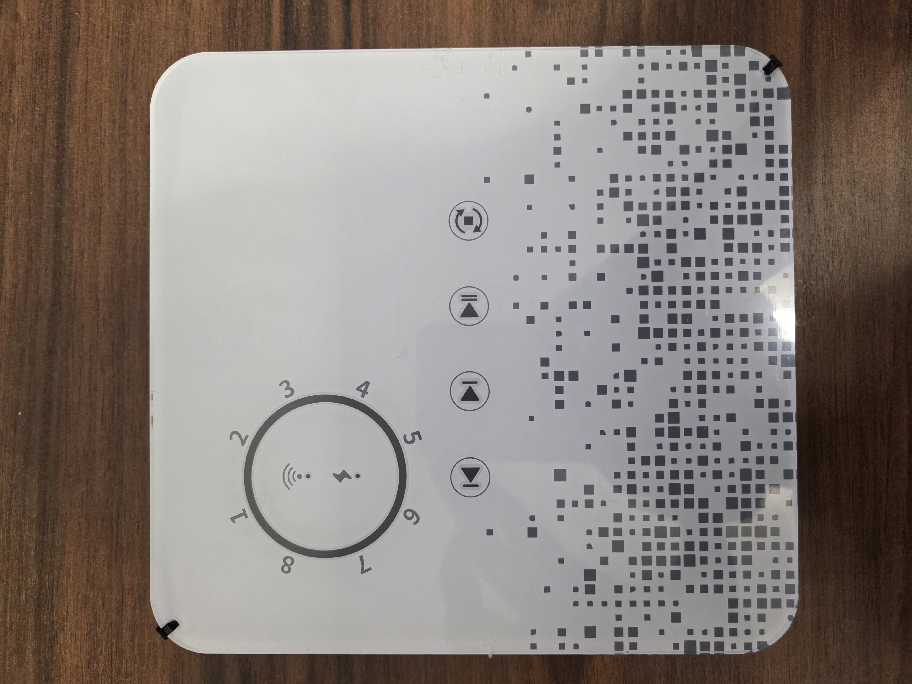

## Installation

You have to disamble the front panel and solder two cable to the RX1 and TX1 pins.
I suggest to flash the device based on this video.

[Flash tutorial](https://www.youtube.com/watch?v=t0o8nMbqOSA)

Here you can find the pinout of the CBU Module.

[CBU Module](https://developer.tuya.com/en/docs/iot/cbu-module-datasheet?id=Ka07pykl5dk4u)





## Basic Configuration

The example contains the device hardware settings. Add your Wi-Fi, API and OTA configuration separately.

```yaml file=config.yaml
```

### Valve queue buttons

Combine this fragment with the hardware configuration above to add the individual valve queue buttons.

```yaml file=valve-queue-buttons.yaml
```
