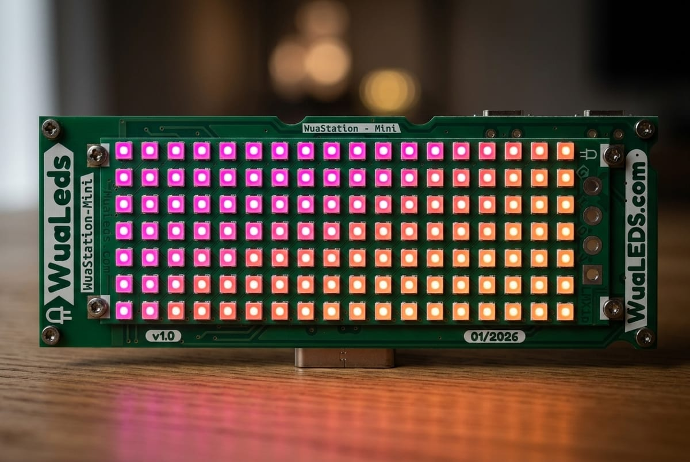

## Description

The [WuaStation mini](https://www.wualeds.com/en/products/wuastation-mini) by Wualeds is a desk station built around
an 18 x 7 RGB LED matrix and an ESP32-C3. It shows the time, date, weather and forecast, indoor readings, a crypto
ticker, messages, a timer and a visual alarm, and works on its own with the settings page it serves.

In Home Assistant it exposes the display as a light, the scrolling message, the screen rotation (a select and one
switch per screen), the buttons as events and every reading as a sensor, plus the `show_message` and `show_screen`
actions.

**Features:**

- 18 x 7 RGB LED matrix (126 SK6805-EC15 LEDs)
- Clock, date, weather and forecast (Open-Meteo), crypto ticker, messages, timer and visual alarm
- Optional indoor sensor on the I2C expansion connector (BME280, SHT4x, SHT3x or AHT2x, detected automatically)
- UP and DOWN buttons and a touch input, exposed to Home Assistant as events
- Settings page served by the station, in English and Spanish
- WiFi set from a phone over Bluetooth (Improv, on only while the station has no network), over USB (Improv
  serial) or from the setup access point
- New firmware offered by the update entity
- USB-C powered, ESP32-C3 with 4 MB flash

## GPIO Pinout

| Pin                          | Function                                         |
| ---------------------------- | ------------------------------------------------ |
| GPIO5                        | LED matrix data (126 x SK6805-EC15)              |
| GPIO9                        | Button UP (also BOOT)                            |
| GPIO4                        | Button DOWN                                      |
| GPIO7                        | Touch input (USB-C SBU1/SBU2, active high)       |
| GPIO3                        | I2C SDA (expansion connector)                    |
| GPIO6                        | I2C SCL (expansion connector)                    |
| GPIO18                       | USB D- (logs, Improv serial)                     |
| GPIO19                       | USB D+                                           |
| GPIO0, GPIO1, GPIO20, GPIO21 | USB-C CC lines (left as inputs, do not use)      |

## Configuration

The configuration the station ships with, from the
[firmware repository](https://github.com/WuaLeds/WuaStation-Mini-firmware):

```yaml url=https://github.com/WuaLeds/WuaStation-Mini-firmware/blob/main/wuastation-mini.yaml
```
