The ASCS Multisensor is an ESP32 room sensor for Home Assistant. A Hi-Link LD2450 mmWave radar tracks up to three
targets and reports their positions and whether they are moving or stationary. An AM2320 measures temperature and
relative humidity, and a BH1750 measures illuminance in lux.

[Product page](https://ascs-online.com/multisensor/) ·
[Setup guide in German](https://ascs-online.com/multisensor-anleitung/)

## Connect to Home Assistant

1. Power the sensor over USB. In Home Assistant, open **Settings → Devices & services**.
2. Use the discovered **Improv via BLE** device to send the credentials for your 2.4 GHz Wi-Fi network.
   Home Assistant needs a Bluetooth adapter or an active Bluetooth proxy within range.
3. Once the sensor joins Wi-Fi, add the discovered **ESPHome** device. Its presence, temperature, humidity and
   illuminance entities are now available for automations.

If Bluetooth provisioning is unavailable, connect to the **ASCS Multisensor Setup** Wi-Fi network and open
`http://192.168.4.1/` to enter the Wi-Fi credentials.

## Configure radar zones

Open the sensor's local IP address over HTTP in a browser. Select one of the three zones, choose **Zeichnen** and drag
a rectangle on the radar map. Choose **Anpassen** to move or resize it. The filter applies to all three zones and can
track the whole area, include only the zones, or exclude them. Select **Auf Sensor speichern** to write the settings
to the radar. The per-zone target counts in Home Assistant let you test each zone by walking into it.

## GPIO pinout

| ESP32 pin | Function                              |
| --------- | ------------------------------------- |
| GPIO16    | UART RX from the LD2450 TX pin        |
| GPIO17    | UART TX to the LD2450 RX pin          |
| GPIO21    | I²C SDA shared by the AM2320 and BH1750 |
| GPIO22    | I²C SCL shared by the AM2320 and BH1750 |

## Firmware

The device ships with ESPHome. Use the firmware update entity in Home Assistant to install a manufacturer update over
Wi-Fi, or use **Take control** in ESPHome Device Builder to customize the configuration.

```yaml url=https://github.com/ASCSadmin/ascs-multisensor/blob/main/main.yaml
```
