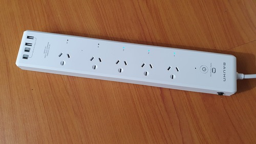
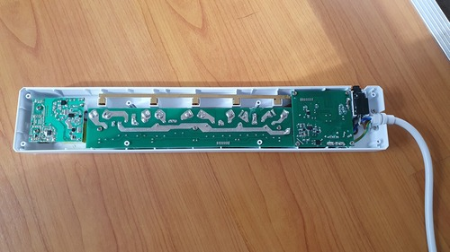
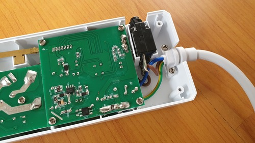
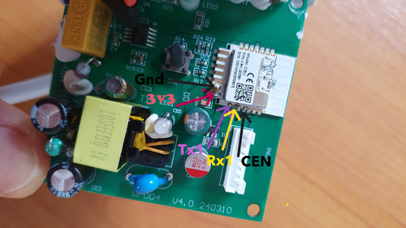

## Product description

This is a Bauhn (Aldi) AP5W-0624 It is a 5-outlet powerboard with separate "always on" 2xUSB-A and 2xUSB-C outlets.
Purchased in July 2024.

The powerboard incorporates a Tuya CBU module incorporating the BK7231N processor.
To realign for ESPHome use I went straight for the "solder and reprogram" method rather than eploring other software
only repogramming options.
The unit is easy to open with "Triangle" socket screws on the back. The CBU module is fairly accessable to solder on the
5 required wires.

[CBU module datasheet](https://developer.tuya.com/en/docs/iot/cbu-module-datasheet?id=Ka07pykl5dk4u)




The powerboard also incorporates power monitoring using the BL0942 chip.

Other features of the board are:

1. Separate relays for each power outlet
2. Surge protection (indicated by an always on green LED)
3. Single addressable blue LED
4. Single momentary push button
5. Resettable overload (10A)

[https://www.aldi.com.au/special-buys/special-buys-sat-29-june/saturday-detail-wk26/ps/p/5-way-surge-protector-powerboard-with-wi-fi-and-meter-reading/](https://www.aldi.com.au/special-buys/special-buys-sat-29-june/saturday-detail-wk26/ps/p/5-way-surge-protector-powerboard-with-wi-fi-and-meter-reading/)

## Pinout

This powerboard incorporates the CBU module

[CBU module datasheet](https://developer.tuya.com/en/docs/iot/cbu-module-datasheet?id=Ka07pykl5dk4u)



### Programming header pinout

| Pin  | Comment                                |
| ---- | -------------------------------------- |
| TX1  | Transmit (connect to Rx on programmer) |
| RX1  | Receive (connect to Tx on programmer)  |
| 3.3v | 3.3V                                   |
| Gnd  | Ground                                 |
| CEN  | Ground to access programming mode      |

### Internal pinout

| Pin | Function        |
| --- | --------------- |
| P22 | Push Button     |
| P28 | Status LED      |
| P6  | Relay #1        |
| P7  | Relay #2        |
| P8  | Relay #3        |
| P9  | Relay #4        |
| P24 | Relay #5        |
| TX1 | Comms to BL0942 |
| RX1 | Comms to BL0942 |

## Button

The setup will turn on plugs 1 to 4 with each short press, then once all plugs are on, turn off plugs 1 to 4 with each
short press.

A long press will toggle all plugs on or off.

## Basic Configuration

Add your own Wi-Fi credentials, API and OTA settings to this hardware configuration.

```yaml file=config.yaml
```
