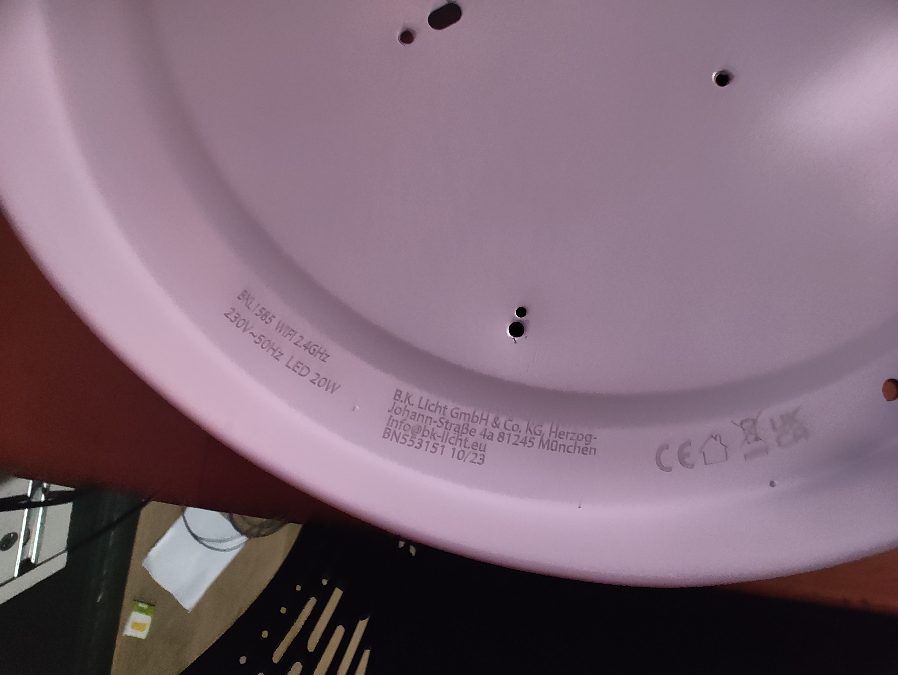
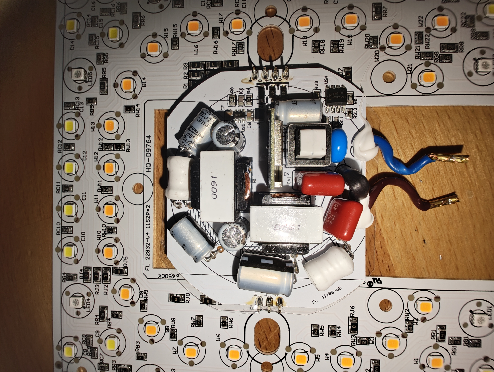
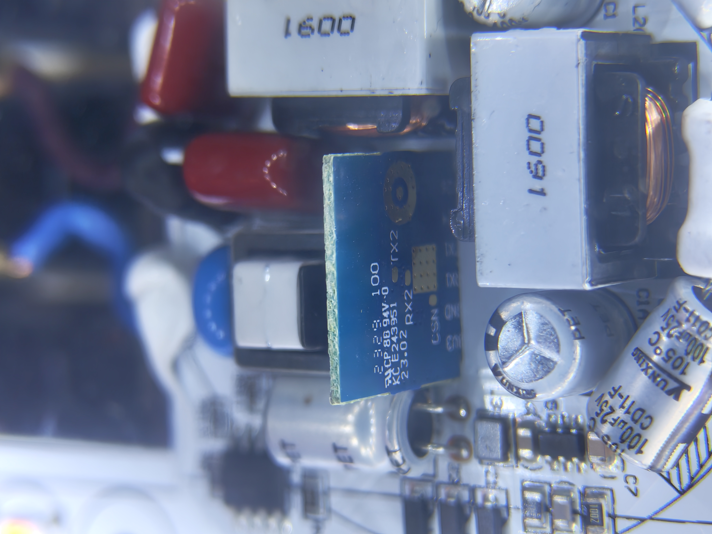
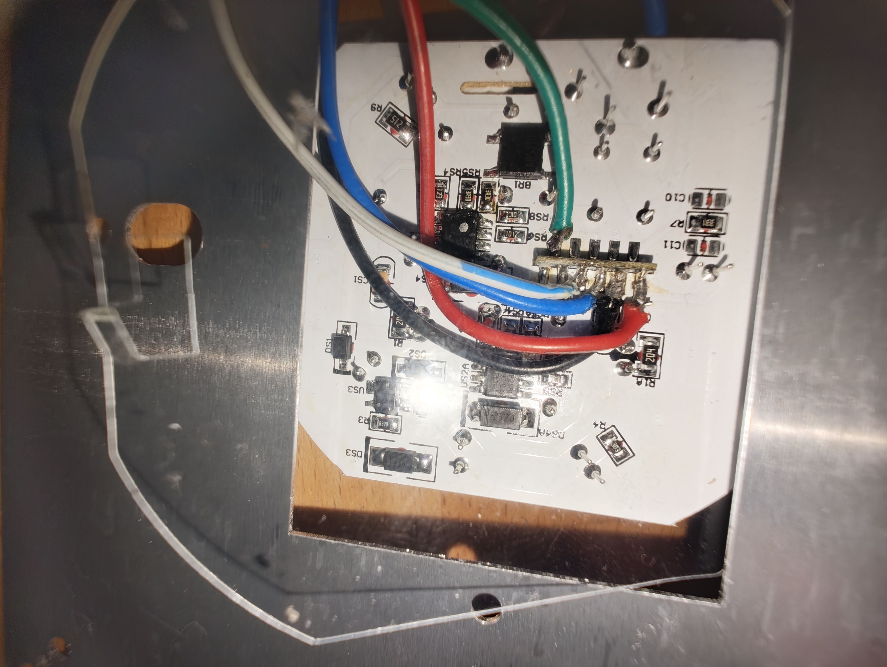

## Overview

The B.K. Licht LSB F03026B is a 20W RGB+CCT smart ceiling light originally controlled by Tuya firmware.

It contains a Tuya CB2S Wi-Fi module based on the BK7231N microcontroller and supports independently controlled red, green, blue, warm-white and cool-white LED channels.

The original Tuya firmware configuration was examined to recover the GPIO assignments. The configuration has been tested on two fixtures running ESPHome.

### Specifications

| Property | Value |
| --- | --- |
| Manufacturer | B.K. Licht |
| Model | LSB F03026B |
| Device type | RGB+CCT ceiling light |
| Operating voltage | 230V AC, 50Hz |
| Rated power | 20W |
| Advertised light output | 2100 lumens |
| Wi-Fi module | Tuya CB2S |
| Microcontroller | BK7231N |
| ESPHome board | `cb2s` |
| PWM frequency | 1000 Hz |
| White LEDs | 22 warm-white and 22 cool-white |
| RGB LEDs | 8 |

### Manufacturer's label



## Hardware

### Internal components



The ceiling light contains an LED board, driver circuitry and a Tuya CB2S Wi-Fi module.

The original firmware controls the five LED channels using PWM.

### CB2S Wi-Fi module



The CB2S uses the BK7231N microcontroller and can be programmed through its UART interface.

### GPIO assignments

The following pin assignments were recovered from the original Tuya configuration and confirmed through functional testing.

| CB2S GPIO | Function |
| --- | --- |
| P6 | Red LEDs |
| P7 | Green LEDs |
| P8 | Blue LEDs |
| P24 | Cool-white LEDs |
| P26 | Warm-white LEDs |

The original Tuya configuration specifies a PWM frequency of `1000 Hz`.

## Flashing ESPHome

**Warning: This is a 230V mains-powered device.**

Disconnect the fixture completely from mains power before disassembly or soldering. Capacitors may retain a dangerous charge after disconnection.

Do not assume that the CB2S circuit is isolated from mains. Before connecting a computer or USB-to-UART adapter, the electrical safety of the connection must be established. Never connect mains power and a USB serial adapter simultaneously.

### 1. Locate the programming connections

The following photograph shows the underside of the circuit board where the programming wires were soldered.



The soldered wire colours are:

| Wire colour | CB2S connection |
| --- | --- |
| Red | 3.3V VCC |
| Black | GND |
| Blue | RX |
| White | TX |
| Green | CEN |

These wire colours describe the installation shown in the photograph, not a universal CB2S colour convention.

### 2. Connect the USB-to-UART adapter

Use a suitable 3.3V logic-level USB-to-UART adapter and an electrically safe, verified power arrangement.

| CB2S wire | USB-to-UART connection |
| --- | --- |
| Red — 3.3V | 3.3V supply, only if safe and appropriate |
| Black — GND | GND |
| Blue — RX | Adapter TX |
| White — TX | Adapter RX |
| Green — CEN | Briefly connect to GND to reset the module |

**Note:** TX and RX are crossed between the module and adapter.

Do not connect 5V to the CB2S 3.3V supply pin.

### 3. Back up the original firmware

It is recommended to read and preserve the stock firmware before flashing ESPHome.

The BK7231N has 2 MiB of flash memory.

The original firmware was successfully backed up with `ltchiptool` on Linux. During testing, some larger reads encountered serial communication errors, so the firmware was read in smaller 64 KiB sections.

An example read command is:

```bash
ltchiptool flash read bk7231n original-part-00.bin \
  -d /dev/ttyUSB0 \
  -B 115200 \
  -b 57600 \
  -s 0x000000 \
  -l 0x10000
```

The serial port may differ depending on the computer and USB adapter.

Stock firmware backups may contain device-specific credentials and should not be published.

### 4. Compile ESPHome firmware

Create an ESPHome configuration using the `cb2s` board and the five PWM GPIO assignments.

The following configuration was tested on two fixtures:

```yaml file=config.yaml
```

For the initial serial installation, compile and download BK7231N-compatible `.uf2` firmware.

### 5. Flash using ltchiptool

Using the downloaded firmware file, run:

```bash
ltchiptool flash write kitchen-light-firmware.uf2 \
  -d /dev/ttyUSB0 \
  -B 115200 \
  -b 57600
```

Replace `kitchen-light-firmware.uf2` with the actual firmware filename.

When the tool is attempting to establish communication, briefly connect the CB2S `CEN` connection to GND and release it to reset the module.

Wait for the flashing tool to report successful completion.

After programming, disconnect the serial adapter. Reassemble the fixture with the driver electronics and mains terminals safely enclosed before restoring mains power.

## ESPHome behaviour and calibration

The five LED channels work with ESPHome's `rgbww` light platform.

During testing, the default ESPHome gamma correction caused the LEDs to stop illuminating at low brightness settings.

Setting `gamma_correct` to `1.0` allowed the LEDs to remain illuminated at 1% brightness and improved smooth transitions between warm-white and cool-white settings.

The configuration also uses `constant_brightness: false` to allow both white channels to contribute to the overall output, and `default_transition_length: 300ms` to smooth brightness and colour-temperature changes.

These settings are included in the tested `config.yaml` configuration referenced above.

The exact dimming curve may differ from the original Tuya firmware. During testing, the stock firmware appeared brighter at equivalent percentage settings, so additional brightness calibration may be desirable.

## Additional notes

- The RGB and white channels use separate PWM outputs at 1000 Hz.
- `logger: baud_rate: 0` was used during testing to disable UART logging.
- ESPHome firmware was successfully installed and tested on two identical CB2S-based fixtures.
- This conversion requires access to the internal circuit board and soldering to the programming connections.
- The 230V LED driver must be treated as potentially hazardous even after disconnection from mains power, due to possible stored charge.
