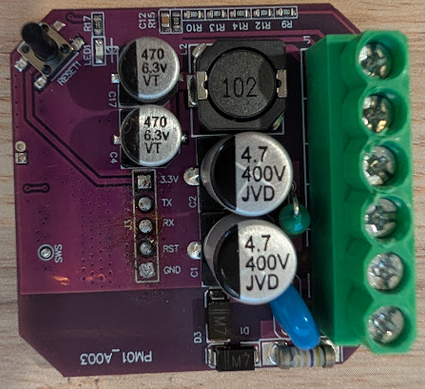
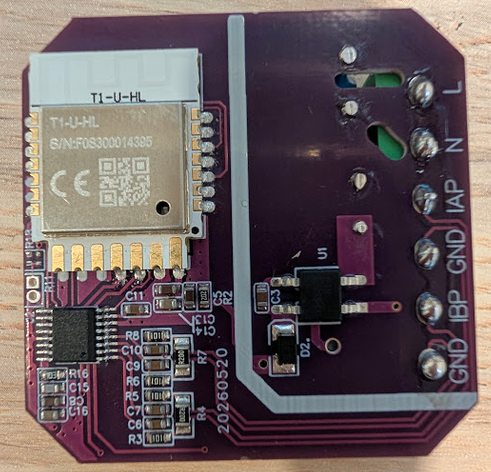

The eMylo PW01 (part AG265) is a two-channel clamp energy monitor sold as the
[2 Channel WiFi Power Meter](https://www.amazon.com/dp/B0D7CV1S1H). Each clamp is rated
0.2–80 A. The meter is rated 100–240 V AC, 50/60 Hz, and uses 2.4 GHz Wi-Fi. Stock
firmware is Smart Life / Tuya.

The board is marked `PW01_A003`. The radio is a Tuya T1-U-HL module (BK7238). Metering
is an HLW8112 on that chip's hardware SPI controller, not a bit-banged bus. ESPHome's
`spi:` component does not support LibreTiny, so the configuration loads
[`bk72xx_spi`](https://github.com/eyal0/bk72xx_spi) for the bus and
[`hlw8112_spi`](https://github.com/eyal0/hlw8112_spi) for the meter.

> **Warning:** Unplug the meter from the mains before opening it or attaching a serial
> adapter. On some of these boards the digital ground is tied to mains, so treat every
> pin, including the UART header, as live until the supply is confirmed isolated.

## Board



The top side has the mains and clamp screw terminal, a reset button, an LED, and a
5-pin programming header labeled 3.3V, TX, RX, RST, and GND.



The T1-U-HL module is on the bottom.

## Pinout

SCK, MOSI, and MISO belong to the BK7238 SPI controller. Chip select is a normal GPIO
because the HLW8112 SCSN pin is not wired to the controller's hardware chip select.
SPI mode is mode 2 (clock idle high, MSB first). The default clock is 500 kHz.

| Signal | T1-U-HL | Notes                                       |
| ------ | ------- | ------------------------------------------- |
| SCK    | P14     | Module pin 1. Owned by the SPI controller.  |
| MOSI   | P16     | Module pin 2. Owned by the SPI controller.  |
| MISO   | P17     | Module pin 20. Owned by the SPI controller. |
| SCSN   | P21     | Module pin 19. Set with `cs_pin`.           |

BK7238 and BK7231N are supported. A BK7231T uses a different SPI register map and the
component rejects it. This meter is a BK7238.

## Flashing

The first install has to go through UART. Later updates can use ESPHome OTA.

Compile the configuration, then flash the app image. `firmware.bin` is a UF2 package
and is not the file to write. Do not write below `0x11000`; that region is the
bootloader.

```console
bk7231tools write_flash -d /dev/ttyUSB0 -s 0x11000 \
  .esphome/build/emylo-power-meter/.pioenvs/emylo-power-meter/image_bk7238_app.0x011000.rbl
```

Use a 3.3 V USB-serial adapter on the programming header. Connect adapter TX to the pin
labeled RX, adapter RX to the pin labeled TX, and GND to GND. Power the board from the
header's 3.3V pin rather than the screw terminals. The link baud rate is 115200. Start
the command, then pulse the pin labeled RST low (or power-cycle the module) while the
tool is trying to connect.

After boot, logs come out of UART2, not the flashing header. To print logs on that
header instead:

```yaml inline
bk72xx:
  board: t1-u
  framework:
    uart_port: 1
```

## Configuration

Add your own Wi-Fi credentials, `api:`, and `ota:` before flashing. The empty `ap:`
block lets a freshly flashed device bring up a fallback hotspot.

ESPHome caches each GitHub component for a day. Set `refresh: 0s` on an
`external_components` entry to pick up a new push immediately.

The current ratios are the component defaults and match the clamp-meter ratios used by
the OpenBeken driver. If a current channel reads high, raise that channel's ratio by
the same factor. `voltage_ratio` is the divider ratio relative to 1 kΩ / 1 MΩ.
`meter_channel` selects which current channel feeds the single apparent-power and
power-factor measurement. The chip has one apparent-power register.

```yaml file=config.yaml
```

`phase_angle` reports degrees, on a 50 Hz or 60 Hz scale chosen from the measured
frequency. `energy_export_a` and `energy_export_b` are exported kWh. The energy
registers clear when they are read, so the component adds each reading into import or
export totals and stores them in flash about every 30 updates, and again on shutdown.

These template buttons clear the stored totals. They use `id(meter)` from the
configuration above.

```yaml file=reset-energy.yaml
```
