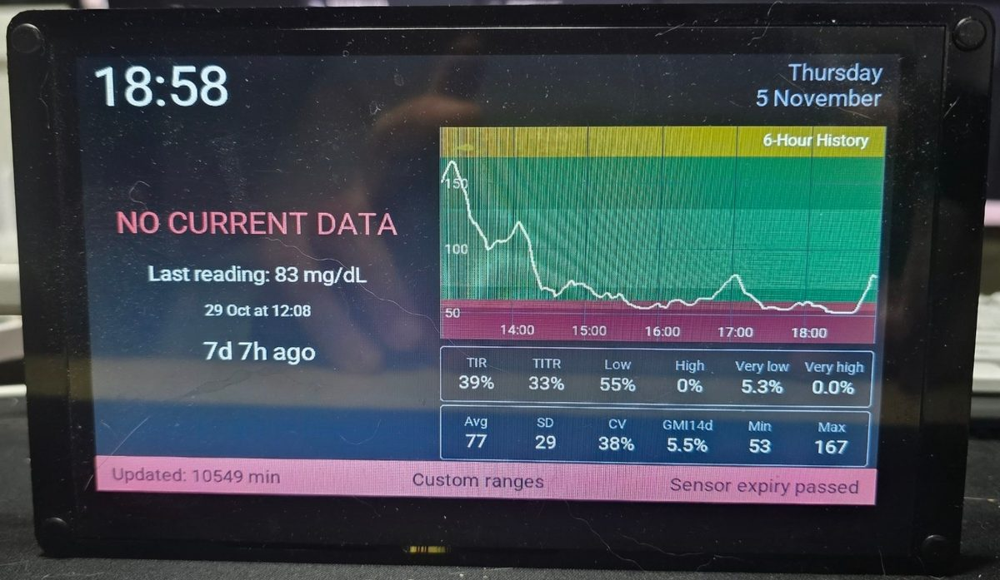

## Product Specs

| Feature | Spec |
|---------|------|
| Screen | EK9716BD3 driver, 800x480, RGB parallel interface |
| Touch | GT911 capacitive, 5-point multi-touch |
| CPU | ESP32-S3-WROOM-1-N4R8 |
| Flash | 4MB |
| PSRAM | 8MB (Octal) |
| I/O Expander | PCA9557 at I2C 0x18 |
| Backlight | PWM on GPIO 2 |
| USB | USB-C via a CH340 USB-serial chip on UART0 (flashing and logs) |
| Power | 5V via USB-C or JST connector |

Product page:
[Elecrow CrowPanel 7.0" ESP32-S3 HMI](https://www.elecrow.com/esp32-display-7-inch-hmi-display-rgb-tft-lcd-touch-screen-support-lvgl.html)

## Important Notes

### I2C Fix Required for GPIO 19/20 (USB_SERIAL_JTAG Pins)

GPIO19 and GPIO20 are shared with the ESP32-S3 USB_SERIAL_JTAG peripheral. The USB PHY pad holds these pins even after
the I2C driver tries to release them, causing continuous `I2C software timeout` errors. This affects ESPHome 2026.3.0
and later (ESP-IDF 5.5.3 and later) and was still present in ESPHome 2026.10.2. As of November 2026, the upstream
issue is still open.

The fix requires a C header file (`usb_disable.h`) that disables the USB PHY pad before the I2C driver initializes.
Create this file in your ESPHome config directory alongside your YAML:

**usb_disable.h:**

```c
#pragma once

#include "soc/usb_serial_jtag_reg.h"
#include "soc/io_mux_reg.h"
#include "hal/usb_serial_jtag_ll.h"

static __attribute__((constructor(101))) void disable_usb_serial_jtag_phy() {
    usb_serial_jtag_ll_phy_enable_pad(false);
    CLEAR_PERI_REG_MASK(USB_SERIAL_JTAG_CONF0_REG, USB_SERIAL_JTAG_USB_PAD_ENABLE);
    CLEAR_PERI_REG_MASK(USB_SERIAL_JTAG_CONF0_REG, USB_SERIAL_JTAG_DP_PULLUP);
    PIN_FUNC_SELECT(IO_MUX_GPIO19_REG, PIN_FUNC_GPIO);
    PIN_FUNC_SELECT(IO_MUX_GPIO20_REG, PIN_FUNC_GPIO);
    PIN_INPUT_ENABLE(IO_MUX_GPIO19_REG);
    PIN_INPUT_ENABLE(IO_MUX_GPIO20_REG);
    REG_SET_BIT(IO_MUX_GPIO19_REG, FUN_PU);
    REG_SET_BIT(IO_MUX_GPIO20_REG, FUN_PU);
    REG_CLR_BIT(IO_MUX_GPIO19_REG, FUN_PD);
    REG_CLR_BIT(IO_MUX_GPIO20_REG, FUN_PD);
}
```

Then list it under `esphome:` `includes:` in your YAML, as the basic configuration below does.

See [#15356](https://github.com/esphome/esphome/issues/15356) for details.

### Flash Size is 4MB, Not 16MB

The ESP32-S3-WROOM-1-**N4**R8 has 4MB flash. The "N4" = 4MB flash, "R8" = 8MB PSRAM. Setting `flash_size: 16MB` causes a
`rst:0x3` boot loop with no log output. This is easy to get wrong because many online examples and even some Elecrow
documentation reference 16MB.

With 4 MB of flash, each of the two OTA slots holds about 1.75 MB. A full LVGL interface with several large fonts used
roughly 91-95 % of that in my builds, so it is worth keeping the number and size of fonts modest.

### The PCA9557 Is Not Needed for Touch

The CrowPanel V3.0 has a PCA9557 I/O expander (I2C 0x18) that is connected to the GT911 reset and interrupt lines.
Touch works without any PCA9557 configuration, because the GT911 comes out of reset on its own at power-on. In my
earlier testing, resetting the GT911 through the PCA9557 broke touch. On ESPHome 2026.10.2, a `reset_pin` on PCA9557
pin 0 worked, but it is not required.

### GT911 I2C Address

The GT911 I2C address is set by the state of GPIO38 during power-on:

- **GPIO38 LOW** -> address **0x5D** (most common)
- **GPIO38 HIGH** -> address **0x14**

ESPHome tries 0x5D first and falls back to 0x14 on its own, so the address does not need to be changed.

If the log shows `Address: 0x14` together with `Calibration error`, the GT911 did not respond at either address. This
points to a hardware problem rather than the address. On one of my units this turned out to be a touch fault that no
configuration could fix. Reseating the touch ribbon cable is a good first check.

## Pin Configuration

| Function | Pin(s) |
|----------|--------|
| I2C SDA (Touch) | GPIO 19 |
| I2C SCL (Touch) | GPIO 20 |
| Touch INT | GPIO 38 |
| Backlight PWM | GPIO 2 |
| Display DE | GPIO 41 |
| Display HSYNC | GPIO 39 |
| Display VSYNC | GPIO 40 |
| Display PCLK | GPIO 0 |
| Red data | GPIO 14, 21, 47, 48, 45 |
| Green data | GPIO 9, 46, 3, 8, 16, 1 |
| Blue data | GPIO 15, 7, 6, 5, 4 |

## Common Pitfalls

| Mistake | Symptom | Fix |
|---------|---------|-----|
| `flash_size: 16MB` | Boot loop, no logging | Change to `4MB` |
| Missing `invert_colors: true` | Wrong colors | Add it |
| Missing `pclk_inverted: true` | Garbled display | Add it |
| Adding `interrupt_pin: 38` | Touch stops responding | Remove it, use polling |
| Missing `usb_disable.h` | `I2C software timeout` | Add the header file (see notes above) |
| Logger not on UART0 | No logs over the USB-C port | Add `logger: hardware_uart: UART0` |

## Basic Configuration

Minimal working config with display, touch and backlight, without LVGL. Requires `usb_disable.h` (see Important Notes
above).

```yaml file=config.yaml
```

## LVGL Configuration

Add LVGL with touch, swipe gestures, and styled pages:

```yaml file=lvgl.yaml
```
