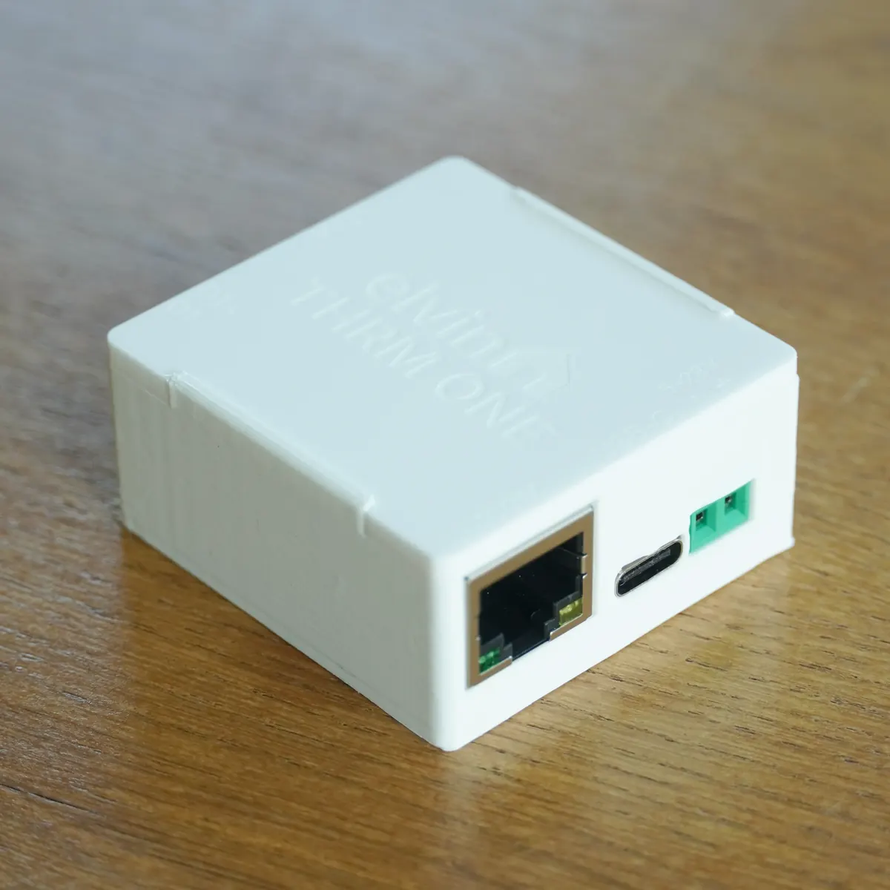
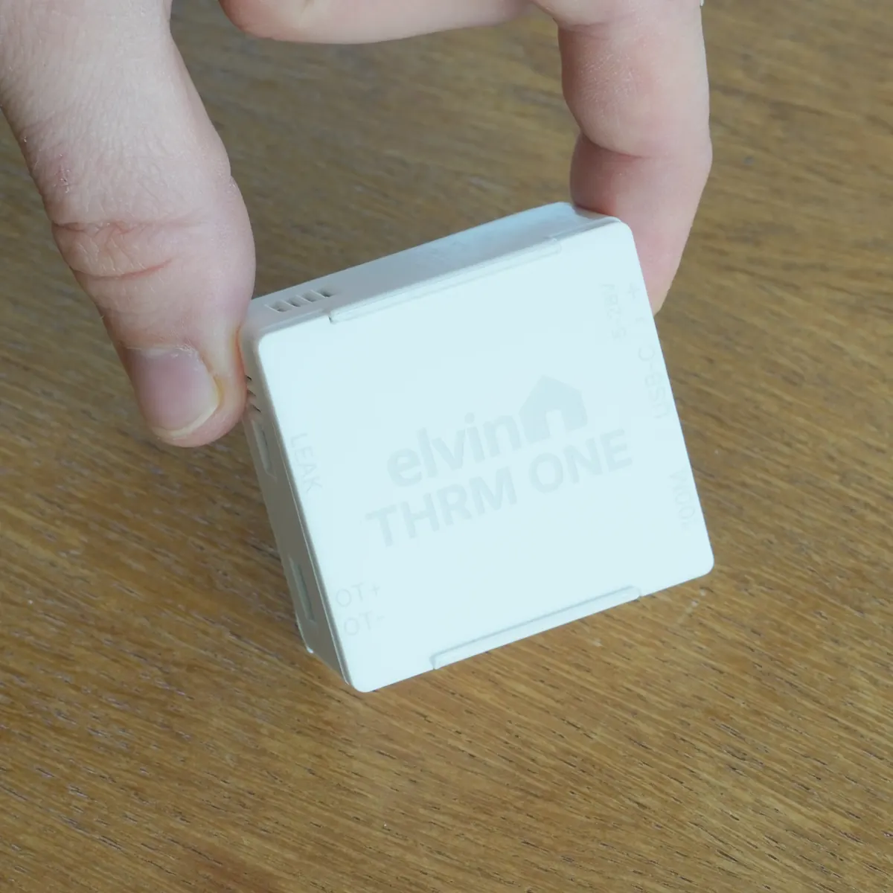
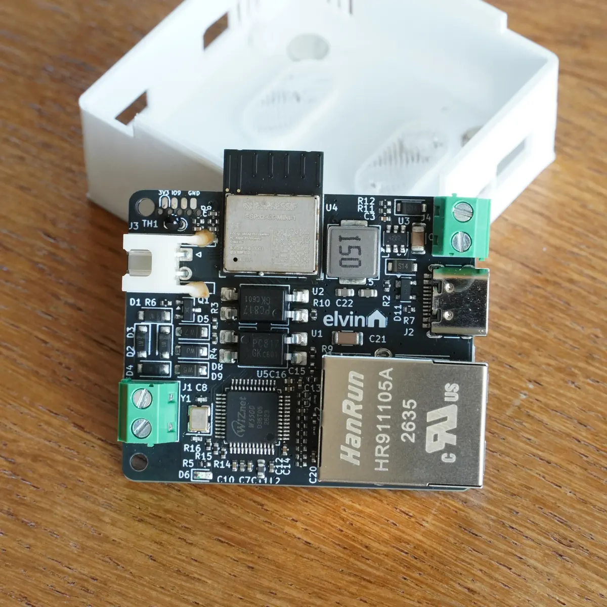
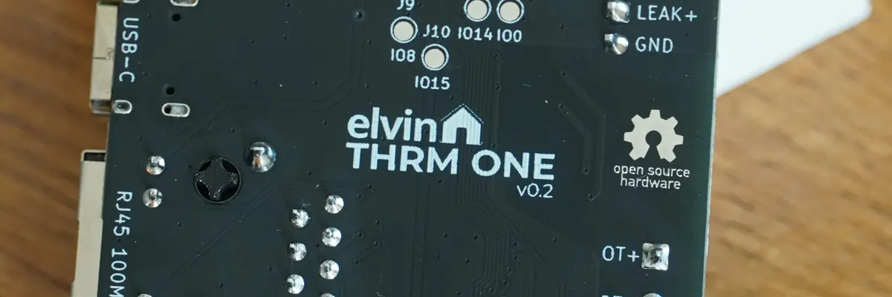

## Product Description

The THRM ONE is a small boiler controller that puts a boiler's OpenTherm® interface under the control of ESPHome.
It's built around the Espressif ESP32-C6 and ships with ESPHome pre-flashed. A WIZnet W5500 adds a 100 Mbit
Ethernet port alongside the ESP32-C6's Wi-Fi 6 radio, and the 802.15.4 radio is available as well if the firmware is
reconfigured for Zigbee or Thread.

It acts as an OpenTherm master, replacing a thermostat or gateway to bring control fully into Home Assistant.
It polls the boiler for flow and return water temperature, modulation level, water pressure, hot water temperature
and the fault flags in the status word, and it writes back the central heating setpoint, the maximum CH setpoint,
the modulation cap and the hot water setpoint. The bus is opto-isolated and the two OpenTherm terminals can be wired
either way round.

The wired water leak sensor can be placed under the boiler to report if water is detected. When an Ethernet cable is
connected it takes priority, and it will fall back to WiFi if Ethernet is unavailable.

The hardware is fully open source, under the CERN-OHL-S license. The source KiCad files can be found in the same
repository as the ESPHome configuration, which is published under GPLv3.

OpenTherm does not carry enough energy to run the board, so the THRM ONE needs external power; 5 V through the USB-C
port, or 5-28 V DC into the screw terminals. The case hangs on two screws or against the boiler casing through the
integrated magnets in the base.

Key hardware:

- Espressif ESP32-C6 module (single-core RISC-V, Wi-Fi 6, Bluetooth LE, 802.15.4).
- WIZnet W5500 100Mbps Ethernet controller (data only, no PoE).
- Opto-isolated OpenTherm interface.
- 5-28 V DC input through screw terminals.
- 10 k NTC (B 3950) on an ADC pin, as a backup air temperature reading.
- Single red status LED.
- USB-C, wired to the ESP32-C6's native USB pins, for power and flashing.
- 2-pin water leak header.

The device targets ESPHome 2026.10.0 or newer.

## GPIO Pinout

| Pin    | Function                                |
| ------ | --------------------------------------- |
| GPIO1  | Status LED (red, PWM)                   |
| GPIO4  | Air temperature NTC (ADC)               |
| GPIO5  | Water leak input, pulled up, active low |
| GPIO6  | OpenTherm receive (behind optocoupler)  |
| GPIO7  | OpenTherm transmit (behind optocoupler) |
| GPIO8  | Bootstrap, pulled up                    |
| GPIO9  | Bootstrap, on the SOICbite header       |
| GPIO12 | USB D-                                  |
| GPIO13 | USB D+                                  |
| GPIO16 | UART TX, on the SOICbite header         |
| GPIO17 | UART RX, on the SOICbite header         |
| GPIO18 | W5500 reset                             |
| GPIO19 | W5500 interrupt                         |
| GPIO20 | SPI MOSI (W5500)                        |
| GPIO21 | SPI MISO (W5500)                        |
| GPIO22 | SPI clock (W5500)                       |
| GPIO23 | W5500 chip select                       |
| EN     | Chip enable, on the SOICbite header     |

Unused GPIO are exposed on the bottom of the board through test pads. SOICbite is a debug header; there is a
[SOICbite write-up](https://elvinhome.io/blog/articles-3/a-cheap-tiny-esp32-programmer-soicbite-40) on programming
the ESP32-C6 through it.

## Factory Configuration

This is the configuration the device ships with, and contains all the necessary logic to set it up in Home Assistant.

```yaml url=https://codeberg.org/elvinhome/thrm-one/src/branch/main/esphome/thrm-one.yaml
```

## Base Hardware Configuration

This contains only the necessary parts for ESPHome to initialize the hardware. Use this as a base for your own configurations.

```yaml url=https://codeberg.org/elvinhome/thrm-one/src/branch/main/esphome/core/base.yaml
```

## Notes

- The NTC is a fallback, not a room sensor. It sits at the board edge next to the boiler, so it reads warmer than the
  room. `Control Room Temperature` (ID24, the room value the boiler is told) is written by Home Assistant while the
  API link is up; a 60 s interval in the firmware takes it over and reports the NTC once the link is gone, so the
  boiler keeps a plausible number instead of one frozen at the last write.
- The water leak sensor is sold separately, and plugs into the water leak port on the side of the device.
- With both interfaces up, `network: priority` makes Ethernet primary and Wi-Fi the fallback. The status LED reports
  the active link.
- Boilers differ in what they implement, and some need specific messages at startup before they answer. The
  [ESPHome OpenTherm component](https://esphome.io/components/opentherm/) documents the boiler-specific options,
  including the handshake IDs.
- OpenTherm® is a registered trade mark of The Open Therm Association. THRM ONE is an independent product. It is not
  affiliated with, endorsed by, certified by or licensed by The Open Therm Association. The name is used only to
  describe interoperability with boilers that implement the OpenTherm® protocol.

## Links

- [Product page](https://elvinhome.io/shop/thrm-one-60)
- [Firmware and hardware source](https://codeberg.org/elvinhome/thrm-one)
- [ESPHome OpenTherm component](https://esphome.io/components/opentherm/)
- [YouTube](https://www.youtube.com/@elvinhome-io)
- [Instagram](https://www.instagram.com/elvinhome.io/)
- [Reddit](https://www.reddit.com/r/elvinhome/)

## Product Images




