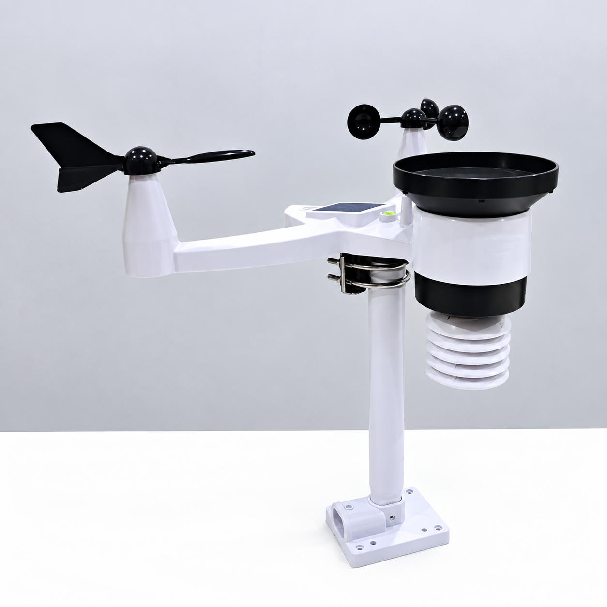

Typical weather station packed with loads of sensors, delivered with preinstalled esphome and based on esp32c6 module.

Hardware is available at [embinotec.de/produktseite/wetterstation](https://www.embinotec.de/produktseite/wetterstation)



## Function range

| Measurand | Sensor / Principal | Unit |
|---|---|---|
| Windspeed | hall (Pulse Counter, 2 pulses/round) | m/s |
| Winddirection | 2× ADC (hall pair), angle via `atan2` | ° |
| Rainfall rate | hall (Pulse Counter) | mm/h |
| Rainfall sum | hall (Total) | mm |
| Outside temperature / -Humidity | SHTC3 (i2c) | °C / % |
| Light intensity/spectrum | tsl2591 (i2c) | – / lx |
| Battery voltage | ADC over divider | V |
| Solar voltage | ADC over divider | V |
| Wifi signal strength | ESPHome internal | dBm |
| Charge indication | GPIO (Binary Sensor) | – |
| Barometrical pressure | BMP580 (i2c) | Pa|

## Configuration

```yaml url=https://github.com/embinotec/embinotec-esphome-weatherstation/blob/master/sanitized/esphome/embinotec-weatherstation.yaml
```