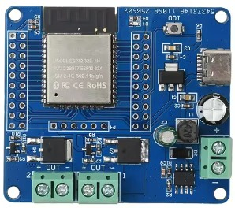
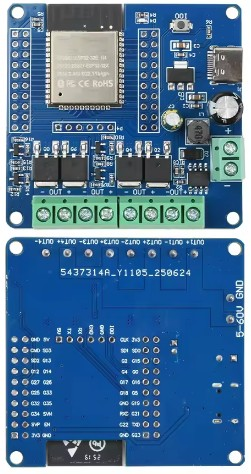

## Product description

A four channel MOSFET switch board built around an ESP32 WROOM module. It is sold on AliExpress as ESP32_MOS_X4
and the PCB is marked 303E32NMOS4. It has four MOSFET outputs on screw terminals, a DC power input terminal, a
USB C socket, an IO0 button and a red LED. The ESP32 GPIOs are broken out on headers along both sides of the board.

The listing gives the DC input range as 5 to 60V. The USB C socket supplies power only; there is no USB serial
chip on the board.

## Pinout

| Pin    | Function                  |
| ------ | ------------------------- |
| GPIO16 | MOSFET output 1           |
| GPIO17 | MOSFET output 2           |
| GPIO26 | MOSFET output 3           |
| GPIO27 | MOSFET output 4           |
| GPIO23 | Red LED (lit when high)   |
| GPIO0  | IO0 button (download mode) |

## Outputs

Each output switches the negative side of its load (low side MOSFET switching). Connect the load's positive to the
supply positive and its negative to that output's switched terminal, and power the board from the same supply as the
loads so they share a ground.

The outputs can be used as plain switches or PWM dimmed with ESPHome's `ledc` output. All four have been tested
driving 12V 1A DC blowers at 25 kHz. For motors, fans, solenoids and other inductive loads, fit a flyback diode
across the load with its cathode to the supply positive.

## Flashing

The board has no USB serial chip and no reset button, so the first flash needs a 3.3V USB to serial adapter.

1. Connect the adapter's TX to the board's RX, RX to TX, and GND to GND.
2. Power the board from its DC input or the USB C socket, not from the adapter's VCC pin.
3. Hold the IO0 button while powering up to enter download mode, then flash.
4. Power cycle without holding IO0 to run the new firmware.

After the first flash, updates can be done over WiFi.

## Basic Config

Each output as an on/off switch, with the red LED as the status LED.

```yaml file=config.yaml
```

## PWM Config

Each output PWM dimmed as a light, with a note in the file on running a fan from an output instead.

```yaml file=pwm-dimmer.yaml
```
