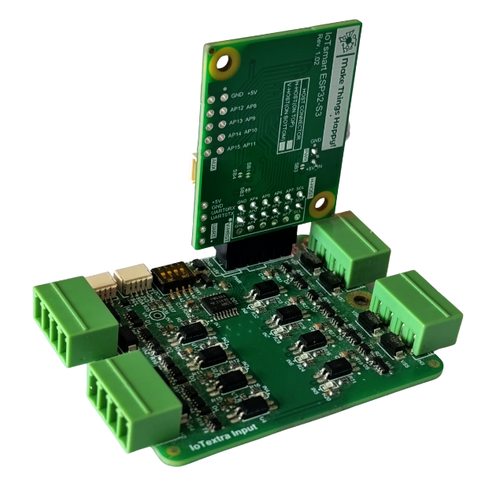
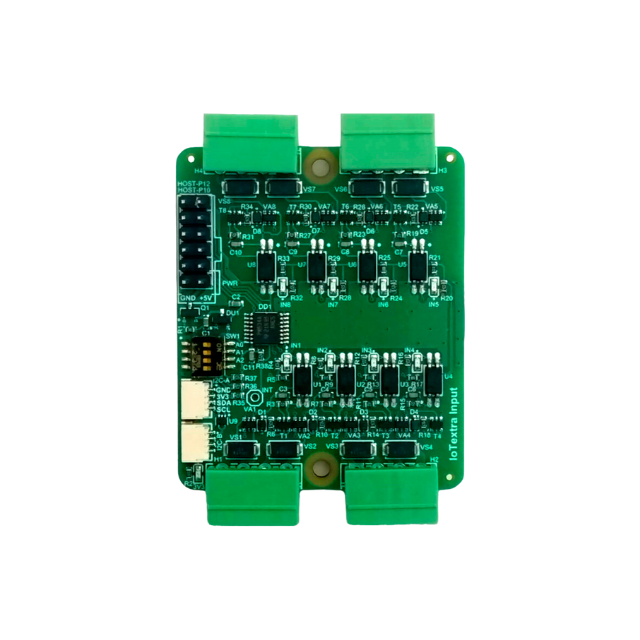
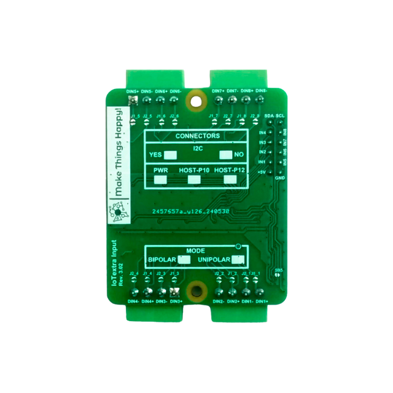

## General Notes

IoTextra Input is an 8-channel digital input module with individual galvanic isolation (3750 Vrms per channel) and TVS
protection on every input. It reads limit switches, emergency-stop buttons, pressure switches, door and window contacts
and other signals up to 36 VDC, for machine and cabinet status monitoring, building automation, smart farming and
security.

- Input voltage up to 36 VDC per isolated channel: 4-36 V is read as active, 0-2 V as inactive
- Per-channel status LEDs; 5 VDC supply with reverse-polarity protection, 47 x 56 mm
- GPIO (AP0-AP7 on the HOST connector) and/or I2C (TCA9534) reading, HOST and Qwiic connectors
- Works with Raspberry Pi, Raspberry Pi Pico / Pico 2 (RP2040 / RP2350) and ESP32; part of the IoTextra series,
  compatible with IoTsmart and IoTbase
- Open source hardware

Datasheet, schematic and 3D model: [IoTextra-Digital
repository](https://github.com/makethingshappy/IoTextra-Digital/tree/main/Input). ESPHome configurations for other
carriers: [MTH-for-ESPHome](https://github.com/makethingshappy/MTH-for-ESPHome). Tasmota templates:
[IoThome](https://github.com/makethingshappy/IoThome).



## Supported carriers

| Input version | Carrier | ESPHome configuration |
| --- | --- | --- |
| 3.02 | IoTsmart ESP32-S3 1.02 | [iotextra-input-v3-02-iotsmart-esp32s3-v1-02-gpio.yaml](https://github.com/makethingshappy/MTH-for-ESPHome/blob/a38f23c006aa3ed14a521c8e01b3ec0af9aadacd/Configs/IoTsmart_ESP32-S3/iotextra-input-v3-02-iotsmart-esp32s3-v1-02-gpio.yaml) |
| 3.02 | IoTsmart ESP32-S3 2.01 | [iotextra-input-v3-02-iotsmart-esp32s3-v2-01-gpio.yaml](https://github.com/makethingshappy/MTH-for-ESPHome/blob/a38f23c006aa3ed14a521c8e01b3ec0af9aadacd/Configs/IoTsmart_ESP32-S3/iotextra-input-v3-02-iotsmart-esp32s3-v2-01-gpio.yaml) |
| 3.02 | IoTsmart XIAO 1.02 + XIAO ESP32-S3 | [iotextra-input-v3-02-iotsmart-xiao-v1-02-gpio.yaml](https://github.com/makethingshappy/MTH-for-ESPHome/blob/a38f23c006aa3ed14a521c8e01b3ec0af9aadacd/Configs/IoTsmart_XIAO_XIAO-ESP32-S3/iotextra-input-v3-02-iotsmart-xiao-v1-02-gpio.yaml) |
| 3.02 | IoTbase NANO 3.06 + Waveshare ESP32-S3-Nano | [iotextra-input-v3-02-iotbase-nano-v3-06-gpio.yaml](https://github.com/makethingshappy/MTH-for-ESPHome/blob/a38f23c006aa3ed14a521c8e01b3ec0af9aadacd/Configs/IoTbase_NANO_Waveshare-ESP32-S3-NANO/iotextra-input-v3-02-iotbase-nano-v3-06-gpio.yaml) |

## GPIO

HOST connector lines AP0..AP7 read channels IN1..IN8. GPIO numbers by carrier:

| Channel | HOST line | IoTsmart ESP32-S3 (1.02 and 2.01) | IoTsmart XIAO + XIAO ESP32-S3 | IoTbase NANO + Waveshare ESP32-S3-Nano |
| --- | --- | --- | --- | --- |
| IN1 | AP0 | GPIO8 | GPIO8 | GPIO9 |
| IN2 | AP1 | GPIO9 | GPIO9 | GPIO10 |
| IN3 | AP2 | GPIO10 | GPIO7 | GPIO17 |
| IN4 | AP3 | GPIO11 | GPIO44 | GPIO18 |
| IN5 | AP4 | GPIO4 | GPIO1 | GPIO4 |
| IN6 | AP5 | GPIO5 | GPIO2 | GPIO3 |
| IN7 | AP6 | GPIO6 | GPIO3 | GPIO2 |
| IN8 | AP7 | GPIO7 | GPIO4 | GPIO5 |
| I2C SDA / SCL | HOST-P12 pins 11 / 12 | GPIO16 / GPIO15 | GPIO5 / GPIO6 | GPIO11 / GPIO12 |

The inputs are active-low on the HOST line (an applied input signal reads as logical 0), so every pin is declared with
`inverted: true`.

## Configuration

Hardware part of the ESPHome configuration for IoTsmart ESP32-S3 2.01, maintained by Make Things Happy: board, I2C and
the channel pins. Add your own `wifi`, `api` and `ota` settings.

```yaml file=config.yaml
```

The full ready-to-flash configuration (Wi-Fi, API, OTA, web server) is [on
GitHub](https://github.com/makethingshappy/MTH-for-ESPHome/blob/a38f23c006aa3ed14a521c8e01b3ec0af9aadacd/Configs/IoTsmart_ESP32-S3/iotextra-input-v3-02-iotsmart-esp32s3-v2-01-gpio.yaml).
The other carriers have their own files, linked in the table above.



## Notes

- Do not use `board: esp32-s3-devkitc-1` for IoTsmart ESP32-S3. Use `variant: esp32s3`, `flash_size: 4MB` and `psram:
  mode: quad`, as in the configuration above.
- IoTsmart ESP32-S3 has a native USB port (no UART bridge): flash the first firmware over USB, later updates over the
  air.
- IoTsmart XIAO uses the Seeed XIAO ESP32-S3, which has no on-board antenna: fit an external 2.4 GHz antenna with a U.FL
  plug before the first start.
- On IoTsmart XIAO, IN4 uses GPIO44 (UART0 RX) and IN7 uses GPIO3 (a strapping pin). On IoTbase NANO, IN6 uses GPIO3 (a
  strapping pin).
- Windows: if your user name contains a space, ESP-IDF builds can fail. Set `ESPHOME_ESP_IDF_PREFIX` and
  `ESPHOME_DATA_DIR` to a path without spaces.
- I2C mode (TCA9534) is not covered by these configurations yet.
