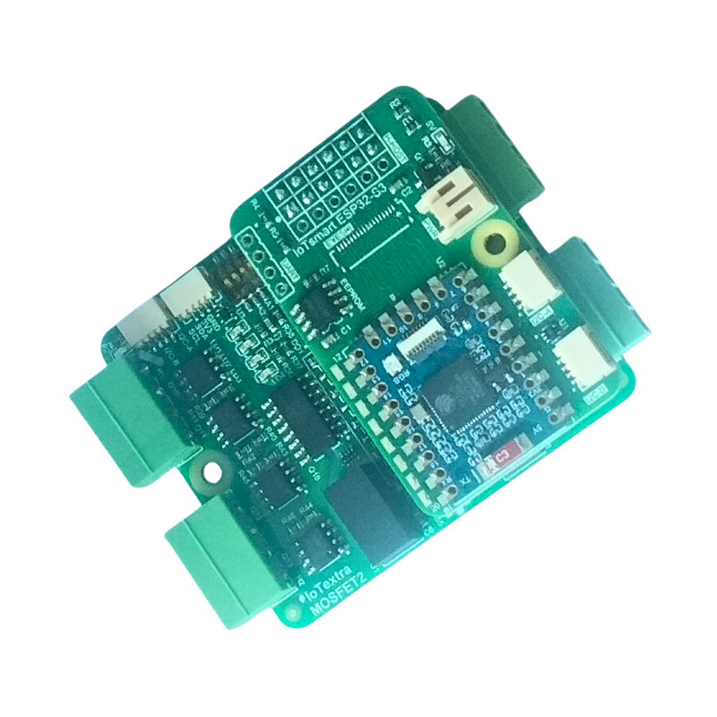
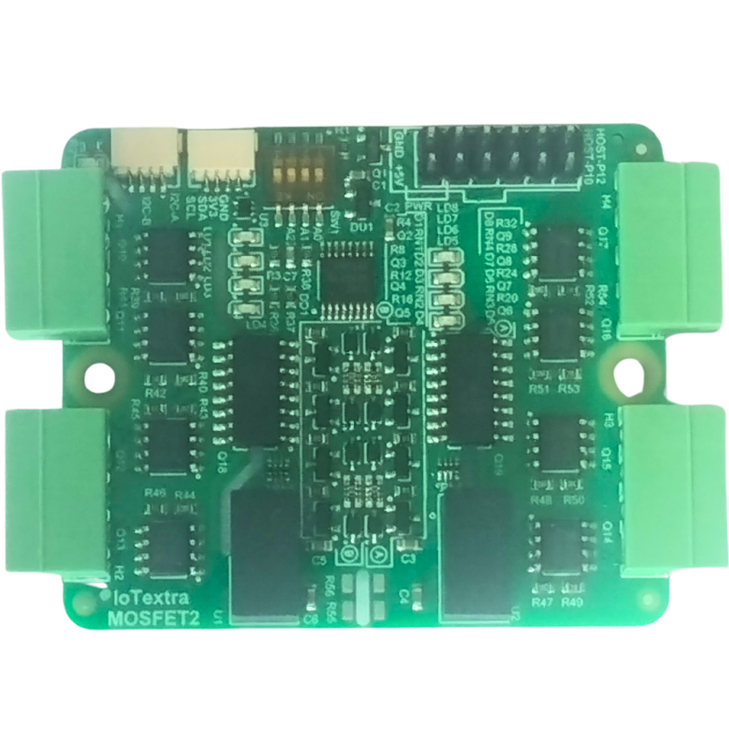
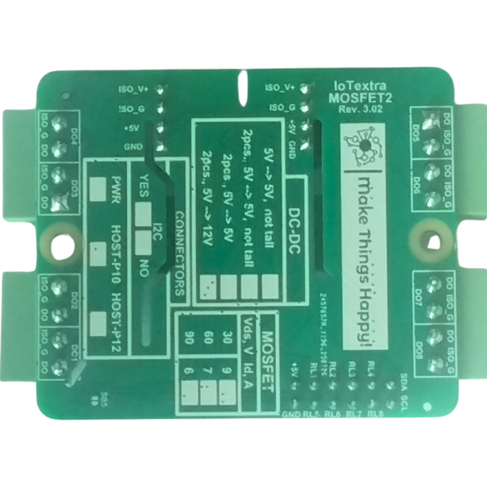

 

 
## General Notes
 
IoTextra MOSFET2 provides eight independent N-channel MOSFET switch channels organized into two isolated 4-channel
groups, each with its own isolated DC-DC converter and 4-channel optocoupler. It is designed for high-speed,
high-current DC load switching with full galvanic isolation: PWM motor control, solenoid valves, LED dimming and
industrial automation.
 
- PWM capable; 5 VDC supply, 47 x 56 mm
- Three MOSFET variants: 30 V / 9 A, 60 V / 7 A or 90 V / 6 A, RDS(on) below 20 mOhm
- GPIO (AP0-AP7 on the HOST connector) and/or I2C (TCA9534) control, HOST and Qwiic connectors
- Works with Raspberry Pi, Raspberry Pi Pico / Pico 2 (RP2040 / RP2350) and ESP32; part of the IoTextra series,
  compatible with IoTsmart and IoTbase
- Open source hardware

Datasheet, schematic and 3D model:
[IoTextra-Digital repository](https://github.com/makethingshappy/IoTextra-Digital/tree/main/MOSFET2). Tasmota templates
and more ESPHome configurations: [IoThome](https://github.com/makethingshappy/IoThome).
 

 
## Supported carriers
 
| MOSFET2 version | Carrier | ESPHome configuration |
|---|---|---|
| 3.02 | IoTsmart ESP32-S3 2.01 | [iotextra-mosfet2-v3-02-iotsmart-esp32s3-v2-01-gpio.yaml](https://github.com/makethingshappy/IoThome/blob/main/ESPHome_Configs/IoTsmart_ESP32-S3/iotextra-mosfet2-v3-02-iotsmart-esp32s3-v2-01-gpio.yaml) |
 
## GPIO
 
HOST connector lines AP0..AP7 drive channels DO1..DO8. GPIO numbers are for IoTsmart ESP32-S3 2.01:
 
| Channel | HOST line | GPIO | Channel | HOST line | GPIO |
|---|---|---|---|---|---|
| DO1 | AP0 | GPIO8 | DO5 | AP4 | GPIO4 |
| DO2 | AP1 | GPIO9 | DO6 | AP5 | GPIO5 |
| DO3 | AP2 | GPIO10 | DO7 | AP6 | GPIO6 |
| DO4 | AP3 | GPIO11 | DO8 | AP7 | GPIO7 |
 
I2C: SDA = GPIO16, SCL = GPIO15.
 
The outputs are active-low (logical 0 turns the MOSFET on), so every pin is declared with `inverted: true`.
 
## Configuration
 
Ready-to-use ESPHome configuration for IoTsmart ESP32-S3, maintained by Make Things Happy
([open on GitHub](https://github.com/makethingshappy/IoThome/blob/main/ESPHome_Configs/IoTsmart_ESP32-S3/iotextra-mosfet2-v3-02-iotsmart-esp32s3-v2-01-gpio.yaml)).
Create `secrets.yaml` next to it with your `wifi_ssid` and `wifi_password`.
 
```yaml url=https://github.com/makethingshappy/IoThome/blob/main/ESPHome_Configs/IoTsmart_ESP32-S3/iotextra-mosfet2-v3-02-iotsmart-esp32s3-v2-01-gpio.yaml
```
 

 
## Notes
 
- Do not use `board: esp32-s3-devkitc-1` for IoTsmart ESP32-S3. Use `variant: esp32s3`, `flash_size: 4MB` and
  `psram: mode: quad`, as in the configuration above.
- IoTsmart ESP32-S3 has a native USB port (no UART bridge): flash the first firmware over USB, later updates over the
  air.
- Windows: if your user name contains a space, ESP-IDF builds can fail. Set `ESPHOME_ESP_IDF_PREFIX` and
  `ESPHOME_DATA_DIR` to a path without spaces.
- I2C mode (TCA9534) is not covered by this configuration yet.
 
