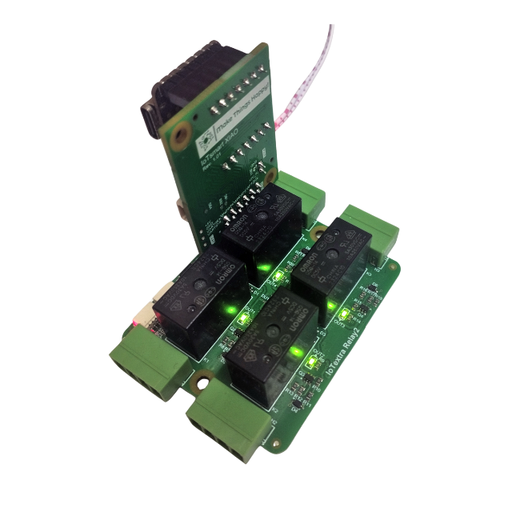
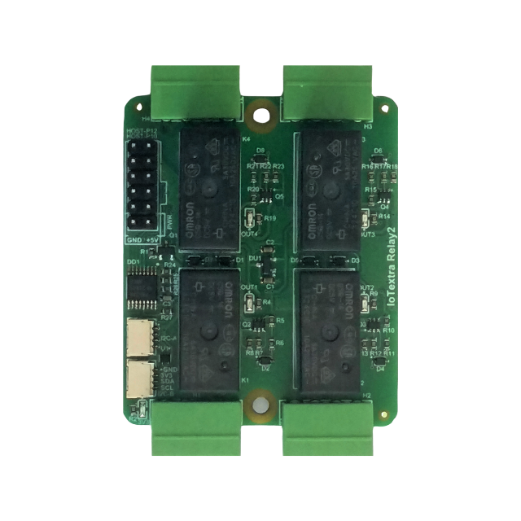
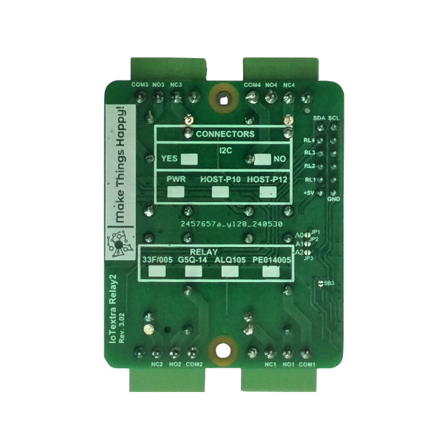

## General Notes

IoTextra Relay2 is a 4-channel SPDT (1 Form C) relay module, 250 VAC / 30 VDC, up to 10 A. It suits contactors, signal
lamps, fans, pumps, solenoid valves, lighting circuits and small DC motors; SPDT gives make and break from one relay.

- 4 SPDT relays, choice of Panasonic ALQ105, Omron G5Q-14, HF33F/005-ZS3 or TE PE014005
- Isolation 4000 Vrms coil-to-contact, 750 Vrms across open contacts, 8000 V surge resistance
- Per-relay status LEDs; 5 VDC supply, 47 x 56 mm
- GPIO (AP0-AP3 on the HOST connector) and/or I2C (TCA9534) control, HOST and Qwiic connectors
- Works with Raspberry Pi, Raspberry Pi Pico / Pico 2 (RP2040 / RP2350) and ESP32; part of the IoTextra series,
  compatible with IoTsmart and IoTbase
- Open source hardware

Datasheet, schematic and 3D model: [IoTextra-Digital
repository](https://github.com/makethingshappy/IoTextra-Digital/tree/main/Relay2). ESPHome configurations for other
carriers: [MTH-for-ESPHome](https://github.com/makethingshappy/MTH-for-ESPHome). Tasmota templates:
[IoThome](https://github.com/makethingshappy/IoThome).



## Supported carriers

| Relay2 version | Carrier | ESPHome configuration |
| --- | --- | --- |
| 3.02 | IoTsmart XIAO 1.02 + XIAO ESP32-S3 | [iotextra-relay2-v3-02-iotsmart-xiao-v1-02-xiao-esp32s3-gpio.yaml](https://github.com/makethingshappy/MTH-for-ESPHome/blob/a9598457c831f702040e549e6b084459b9cce84a/Configs/IoTsmart_XIAO_XIAO-ESP32-S3/iotextra-relay2-v3-02-iotsmart-xiao-v1-02-xiao-esp32s3-gpio.yaml) |
| 3.02 | IoTsmart ESP32-S3 1.02 | [iotextra-relay2-v3-02-iotsmart-esp32s3-v1-02-gpio.yaml](https://github.com/makethingshappy/MTH-for-ESPHome/blob/a9598457c831f702040e549e6b084459b9cce84a/Configs/IoTsmart_ESP32-S3/iotextra-relay2-v3-02-iotsmart-esp32s3-v1-02-gpio.yaml) |
| 3.02 | IoTsmart ESP32-S3 2.01 | [iotextra-relay2-v3-02-iotsmart-esp32s3-v2-01-gpio.yaml](https://github.com/makethingshappy/MTH-for-ESPHome/blob/a9598457c831f702040e549e6b084459b9cce84a/Configs/IoTsmart_ESP32-S3/iotextra-relay2-v3-02-iotsmart-esp32s3-v2-01-gpio.yaml) |
| 3.02 | IoTbase NANO 3.06 + Waveshare ESP32-S3-Nano | [iotextra-relay2-v3-02-iotbase-nano-v3-06-ws-esp32s3-nano-gpio.yaml](https://github.com/makethingshappy/MTH-for-ESPHome/blob/a9598457c831f702040e549e6b084459b9cce84a/Configs/IoTbase_NANO_Waveshare-ESP32-S3-NANO/iotextra-relay2-v3-02-iotbase-nano-v3-06-ws-esp32s3-nano-gpio.yaml) |
| 3.02 | IoTbase PICO 3.05 + Raspberry Pi Pico W | [iotextra-relay2-v3-02-iotbase-pico-v3-05-pico-w-gpio.yaml](https://github.com/makethingshappy/MTH-for-ESPHome/blob/a9598457c831f702040e549e6b084459b9cce84a/Configs/IoTbase_PICO_Raspberry-Pi-Pico-W/iotextra-relay2-v3-02-iotbase-pico-v3-05-pico-w-gpio.yaml) |

## GPIO

HOST connector lines AP0..AP3 drive relays RL1..RL4 (K1..K4). AP4..AP7 are not used by the module in GPIO mode.
GPIO numbers by carrier:

| Channel | HOST line | IoTsmart XIAO + XIAO ESP32-S3 | IoTsmart ESP32-S3 (1.02 and 2.01) | IoTbase NANO + Waveshare ESP32-S3-Nano | IoTbase PICO + Raspberry Pi Pico W |
| --- | --- | --- | --- | --- | --- |
| RL1 | AP0 | GPIO8 | GPIO8 | GPIO9 | GPIO10 |
| RL2 | AP1 | GPIO9 | GPIO9 | GPIO10 | GPIO11 |
| RL3 | AP2 | GPIO7 | GPIO10 | GPIO17 | GPIO12 |
| RL4 | AP3 | GPIO44 | GPIO11 | GPIO18 | GPIO13 |
| I2C SDA / SCL | HOST-P12 pins 11 / 12 | GPIO5 / GPIO6 | GPIO16 / GPIO15 | GPIO11 / GPIO12 | GPIO20 / GPIO21 |

All outputs are active-low on the HOST line (logical 0 switches a relay on), so every pin is declared with
`inverted: true`.

## Configuration

Hardware part of the ESPHome configuration for IoTsmart XIAO 1.02 + XIAO ESP32-S3, maintained by Make Things Happy:
board, I2C and the channel pins. Add your own `wifi`, `api` and `ota` settings.

```yaml file=config.yaml
```

The full ready-to-flash configuration (Wi-Fi, API, OTA, web server) is [on
GitHub](https://github.com/makethingshappy/MTH-for-ESPHome/blob/a9598457c831f702040e549e6b084459b9cce84a/Configs/IoTsmart_XIAO_XIAO-ESP32-S3/iotextra-relay2-v3-02-iotsmart-xiao-v1-02-xiao-esp32s3-gpio.yaml).
The other carriers have their own files, linked in the table above.



## Notes

- IoTsmart XIAO uses the Seeed XIAO ESP32-S3, which has no on-board antenna: fit an external 2.4 GHz antenna with a U.FL
  plug before the first start.
- IoTsmart XIAO: power the board either from USB or from the PWR connector, not from both at the same time. Use the PWR
  connector for real loads.
- For the XIAO ESP32-S3 use `variant: esp32s3` and `flash_size: 8MB`, as in the configuration above. First flash over
  USB; if the port does not appear, use the boot and reset buttons of the XIAO board.
- On IoTsmart XIAO, RL4 uses GPIO44 (UART0 RX).
- With IoTbase carriers or horizontally mounted IoTsmart versions (V-HOST connector), Relay2 needs a height extender or a
  riser adapter.
- Do not use `board: esp32-s3-devkitc-1` for IoTsmart ESP32-S3. Use `variant: esp32s3`, `flash_size: 4MB` and `psram:
  mode: quad`.
- IoTbase PICO with Raspberry Pi Pico W uses the RP2 platform (`rp2:`, `board: rpipicow`). First flash: hold BOOTSEL
  while plugging in USB and copy the `firmware.uf2` file to the RPI-RP2 drive; later updates over the air.
- Windows: if your user name contains a space, ESP-IDF builds can fail. Set `ESPHOME_ESP_IDF_PREFIX` and
  `ESPHOME_DATA_DIR` to a path without spaces.
- I2C mode (TCA9534) is not covered by these configurations yet.
