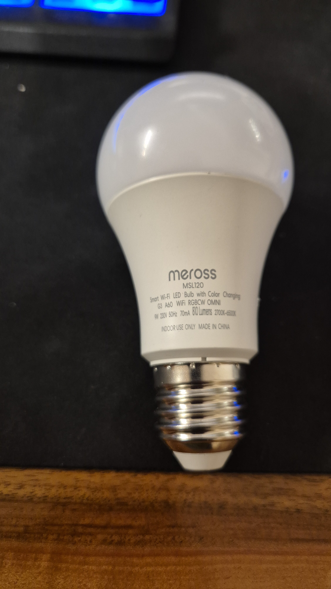
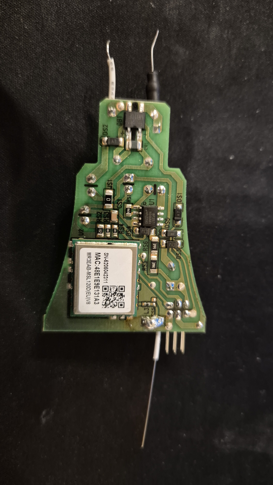
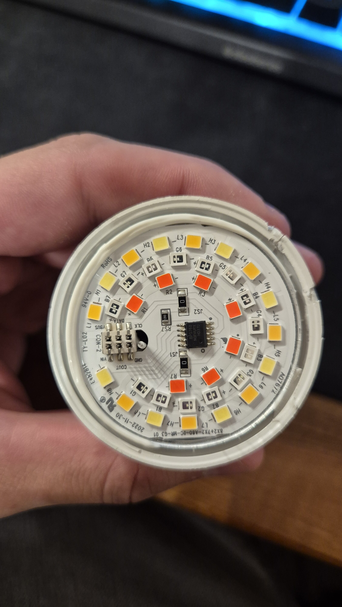
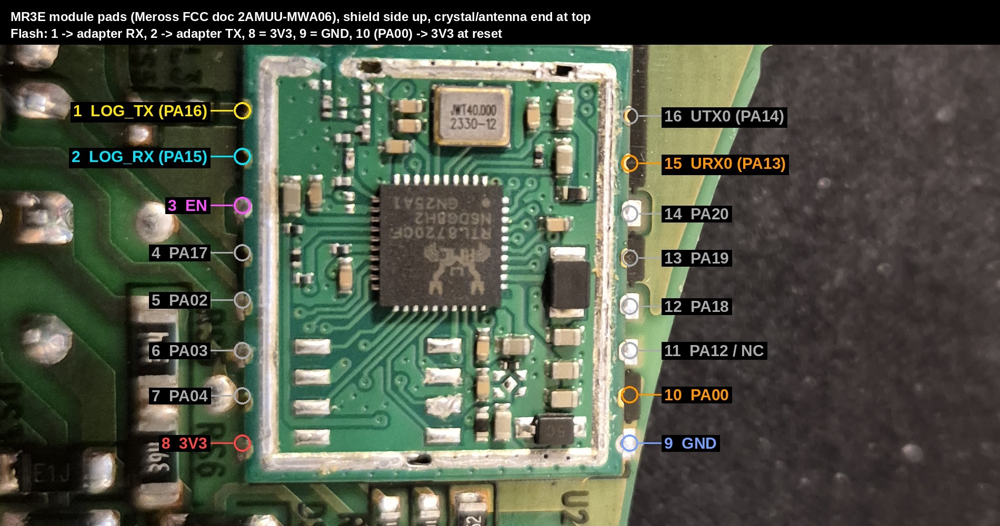

## Meross MSL120DA (Smart RGBWW Bulb)

The [MSL120DA](https://shop.meross.com/products/meross-smart-led-light-bulb-1) is an E27
Wi-Fi RGBWW bulb (9 W, 810 lm, 2700–6500 K). Unlike older Meross bulbs it does **not**
use an ESP chip; it runs standard ESPHome through [LibreTiny](https://docs.libretiny.eu/)
(the `rtl87xx` platform is built into ESPHome). Flashing requires opening the bulb and a
UART connection; there is no over-the-air route onto the stock firmware (the local
Realtek upload server is gated behind a factory-mode flag, and cloud OTA is signed).
Once ESPHome is on, **OTA updates work normally**.



## Hardware

- **MCU:** Realtek **RTL8720CF** (AmebaZ2 family), on a Meross **MR3E** Wi-Fi module.
  Internal 2 MB flash (no external flash chip). LibreTiny board:
  `generic-rtl8720cf-2mb-992k`.
- **LED driver:** **BP5758D** 5-channel constant-current driver on the LED board,
  controlled over a 2-wire (I2C-like) bus: DATA + CLK.
- Mains power supply is **non-isolated** — never connect USB-UART while the bulb is
  on mains.



### Channel mapping (from the stock firmware)

| BP5758D channel | colour     | current |
| --------------- | ---------- | ------- |
| 1               | blue       | 15 mA   |
| 2               | green      | 8 mA    |
| 3               | red        | 10 mA   |
| 4               | warm white | 28 mA   |
| 5               | cold white | 28 mA   |

DATA = **PA3**, CLK = **PA2**.

These pins and currents were read out of the stock firmware's per-model config
table, which also covers the related variants:

| Model / region                | DATA | CLK  | currents ch1–5 (mA) |
| ----------------------------- | ---- | ---- | ------------------- |
| **MSL120DA / EU** (this page) | PA3  | PA2  | 15, 8, 10, 28, 28   |
| MSL120DA / US                 | PA3  | PA2  | 30, 18, 18, 54, 54  |
| MSL120D / EU                  | PA19 | PA20 | 20, 20, 20, 33, 33  |
| MSL120D / US                  | PA19 | PA20 | 30, 30, 30, 60, 60  |

Channel order (ch1→ch5) is blue, green, red, warm white, cold white — confirmed on
the MSL120DA; the MSL120D is a different board, so its order is unverified.



## Flashing

You need a USB-UART (3.3 V) adapter and [`ltchiptool`](https://github.com/libretiny-eu/ltchiptool).
The RTL8720CF cannot be bricked over UART (the ROM bootloader is in mask ROM), so a
bad flash is always recoverable.

The Wi-Fi module's castellated pads (front side, crystal up):

| pad | signal        | connect to                   |
| --- | ------------- | ---------------------------- |
| 1   | LOG_TX (PA16) | adapter **RX**               |
| 2   | LOG_RX (PA15) | adapter **TX**               |
| 8   | 3V3           | regulated 3.3 V              |
| 9   | GND           | GND (adapter **and** supply) |
| 10  | GPIO0 / PA00  | 3V3 (download-mode strap)    |
| 15  | URX0 / PA13   | 3V3 (download-mode strap)    |



First build the firmware: create a device in the ESPHome Device Builder using the
[configuration below](#basic-configuration) plus your own `wifi:`, `api:` and `ota:`
blocks, then use **Install → Manual download** to compile it and download the UF2.
Save it as `firmware.uf2` next to where you run `ltchiptool`.

Steps:

1. **Solder all wires down, hands-free.** This is the single most important tip —
   hand-held wires are intermittent and will not link reliably.
2. **Power from a solid 3.3 V supply**, not the adapter's 3.3 V pin (Wi-Fi current
   spikes brown out weak supplies; the CH340 can drop off USB).
3. Enter download mode: strap **both PA00 and PA13 to 3.3 V**, then power-cycle.
4. **Back up the stock firmware first** (it holds the device's unique MAC/keys). Find the
   adapter's serial port (e.g. `/dev/ttyUSB0` or `COM3`) and pass it with `-d` to both
   commands, re-checking it after any re-enumeration:
   `ltchiptool flash read realtek-ambz2 stock.bin -d /dev/ttyUSB0 -b 115200 -B 115200`
5. Flash ESPHome: `ltchiptool flash write firmware.uf2 -d /dev/ttyUSB0 -b 115200 -B 115200`
   — **use 115200 baud**; auto/higher baud tends to time out mid-transfer.
6. Remove the straps and power-cycle to boot ESPHome.

### Gotchas

- **PA2/PA3 (CLK/DATA) double as ROM boot-strap pins.** If anything holds them at the
  wrong level at power-up you get `[SPIF Err]Invalid ID` / `Flash init error` and it
  won't boot. In the assembled bulb it's fine; on the bench, keep stray loads off
  those two pins.
- The CH340 may re-enumerate to a new `/dev/ttyUSBx` after a power glitch — re-check
  the device path.

## Basic Configuration

The config below is hardware-only (LED driver + light). Add your own
`wifi:`, `api:` and `ota:` blocks, or import it into the ESPHome Device
Builder which adds those for you.

```yaml file=config.yaml
```
