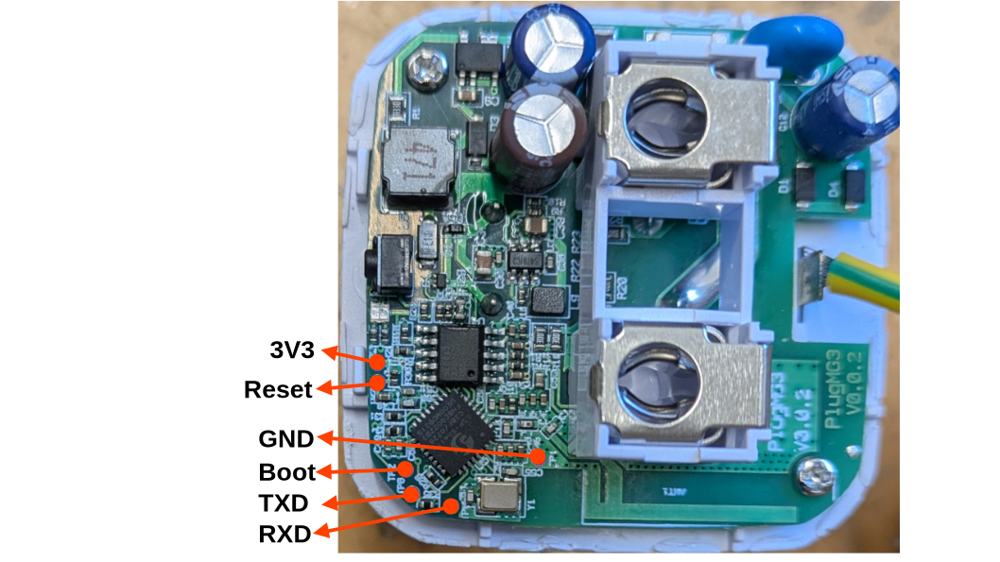

The Shelly Plug M Gen3 is a Wi-Fi and Bluetooth smart plug with power
monitoring, based on an ESP32. It uses a BL0942 energy metering chip and
has a relay, a button and two status LEDs.

[Product Link](https://www.shelly.com/de/products/shelly-plug-m-gen3-white)



Disconnect the plug from mains before opening it or connecting a serial adapter. Never connect mains power while
an adapter is attached. For flashing, use a 3.3 V supply and 3.3 V UART logic.

To enter bootloader mode, Boot needs to be pulled down (connected to ground).

## GPIO Pinout

| Pin    | Function  |
| ------ | --------- |
| GPIO1  | NTC       |
| GPIO5  | BL0942 TX |
| GPIO4  | BL0942 RX |
| GPIO19 | Blue LED  |
| GPIO10 | Green LED |
| GPIO7  | Button    |
| GPIO0  | Relay     |

## Basic Configuration

```yaml file=config.yaml
```

```yaml file=led_flash.yaml
```
