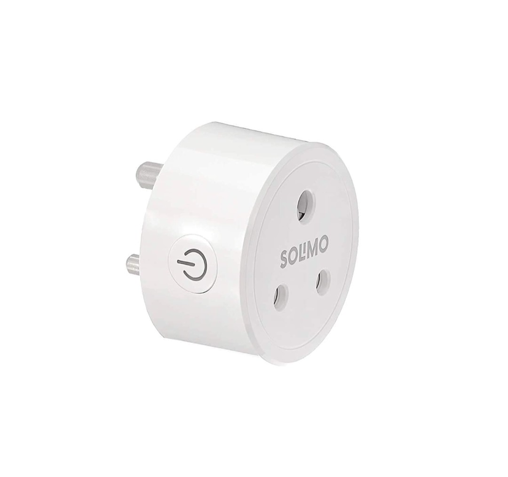

The Solimo Power Monitoring Plug 6A measures voltage, current, power and energy. 
It uses an RTL8710BN and a BL0937 power-monitoring chip.

## Flashing

The plug is not flashable over the air out of the box, so it needs soldering.

## GPIO Pinout

| Pin  | Function                  |
|------|---------------------------|
| PA18 | Push button               |
| PA23 | Blue LED (inverted)       |
| PA00 | Relay                     |
| PA15 | BL0937 SEL pin (inverted) |
| PA05 | BL0937 CF pin             |
| PA12 | BL0937 CF1 pin            |

## Basic Config

```yaml file=config.yaml

```
