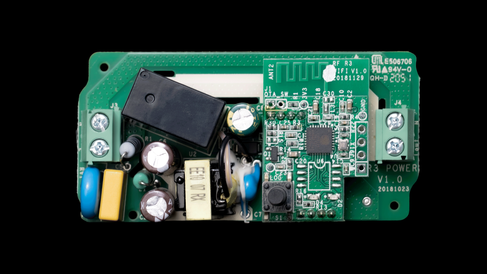
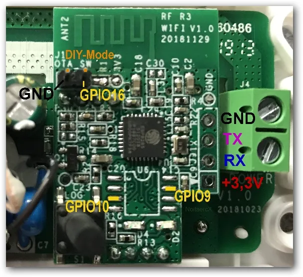

## Overview

The [SONOFF Basic R3](https://itead.cc/product/sonoff-basicr3-wifi-diy-smart-switch/) is a classic,
cost-effective single-relay DIY module.
It is widely used to make basic home appliances and lighting smart.
Based on the ESP8285 chip, it provides a reliable and straightforward way
to integrate your home electronics into Home Assistant via ESPHome.

## Initial Install

This device requires disassembly and a serial connection for the first ESPHome firmware upload,
as it does not support tuya-convert.
Disconnect the device from mains before opening it, and keep mains disconnected throughout serial flashing.
Use a suitable 3.3 V supply and a UART adapter with 3.3 V logic levels; never apply 5 V to the ESP's power or serial pins.
Hold down the physical button while applying the 3.3 V supply to enter bootloader mode.

## GPIO Pinout

| Pin    | Function                           |
| ------ | ---------------------------------- |
| GPIO0  | Push Button (HIGH = off, LOW = on) |
| GPIO12 | Relay                              |
| GPIO13 | Status LED (HIGH = off, LOW = on)  |

## PCB






## ESPHome Configuration

The basic configuration contains the hardware definitions and core ESPHome components.

```yaml file=config.yaml
```

## Advanced Configuration

This configuration adds the Home Assistant API, OTA updates, and diagnostic sensors.
You will need to provide your own Wi-Fi credentials.

To combine `config.yaml` above with `extras.yaml` below in one file, keep each top-level key only once.
Use the `wifi:` settings from `extras.yaml`, and append its status sensor to the existing
`binary_sensor:` list without removing the GPIO button. Copy the remaining top-level sections from both files.

```yaml file=extras.yaml
```
