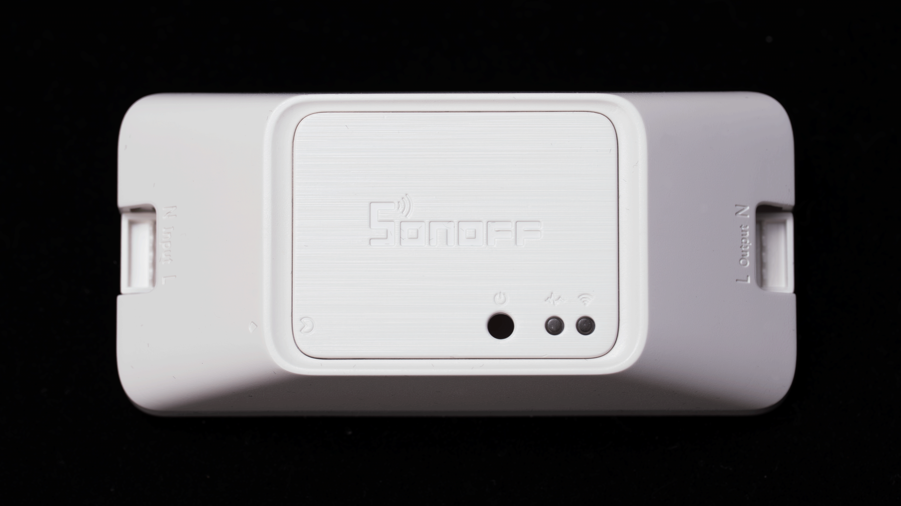
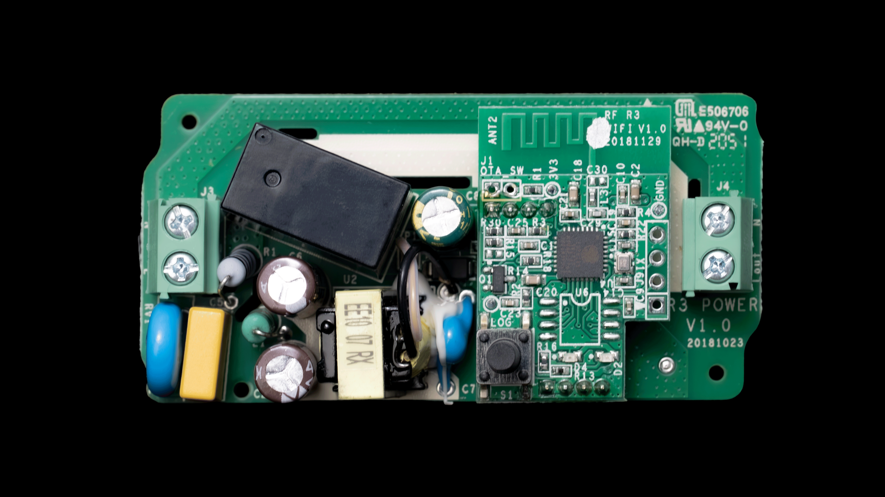
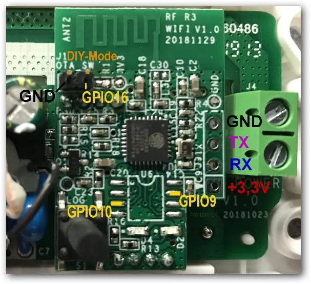

## Overview

The SONOFF Basic R3 is a classic, cost-effective single-relay DIY module. It is widely used to make basic home appliances and lighting smart. 
Based on the ESP8285 chip, it provides a reliable and straightforward way to integrate your home electronics into Home Assistant via ESPHome.

## Initial Install

This device requires disassembly and a serial connection for the first ESPHome firmware upload, as it does not support tuya-convert. 
To flash the firmware, hold down the physical button while powering on the device to put it into bootloader mode.

## GPIO Pinout

| Pin    | Function                           |
| ------ | ---------------------------------- |
| GPIO0  | Push Button (HIGH = off, LOW = on) |
| GPIO12 | Relay                              |
| GPIO13 | Status LED (HIGH = off, LOW = on)  |

## PCB







## ESPHome Configuration

The basic configuration contains the hardware definitions and core ESPHome components for the SONOFF Basic R3.

```yaml file=config.yaml
```

## Advanced Configuration

This configuration adds the Home Assistant API, OTA updates, and diagnostic sensors. You will need to provide your own Wi-Fi credentials.

Note: When using this configuration, please merge the contents of the two YAML blocks above into a single configuration file for your device.

```yaml file=extras.yaml
```
