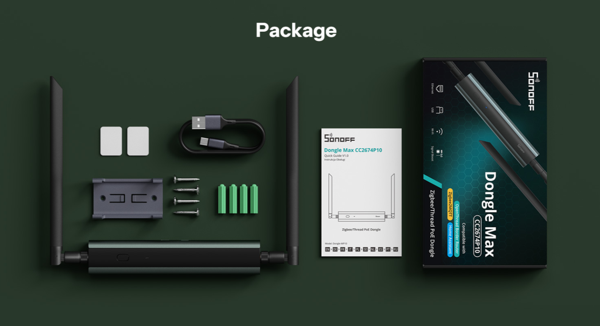
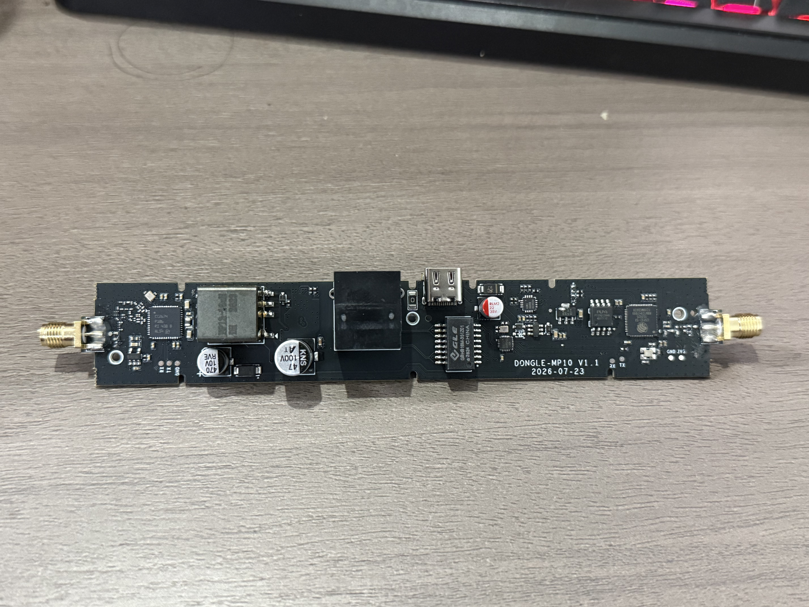

## Description

Dongle-MP10 uses a dual-chip architecture consisting of an ESP32-S3 (Wi-Fi SoC) and a CC2674P10 (Zigbee/Thread SoC).
The ESP32-S3 handles functions such as Wi-Fi and Ethernet,
and provides a TCP port for transmitting and receiving serial data from the CC2674P10.
The CC2674P10 serves as a Zigbee NCP (Zigbee Coordinator), Zigbee Router, OpenThread RCP.

**Note:** ESPHome firmware runs exclusively on Dongle-MP10's ESP32-S3 Wi-Fi SoC.
Flashing ESPHome firmware onto Dongle-MP10 will not affect the functionality of the firmware on the CC2674P10 SoC.

 ")
 

## Quick Start

1. Copy below advanced yaml into ESPHome Builder
2. Compile and flash the firmware to Dongle-MP10's ESP32-S3
3. Add it to Home Assistant via the ESPHome integration.
4. (Optional) Flash the CC2674P10 firmware and connect it to open-source platform

## GPIO Pinout

 

| Function | ESP32-S3 GPIO | Direction | Notes |
| :--- | :--- | :--- | :--- |
| CC2674P10 UART RX | GPIO18 | Input | Data from CC2674P10 to ESP32-S3 |
| CC2674P10 UART TX | GPIO17 | Output | Data from ESP32-S3 to CC2674P10 |
| CC2674P10 Reset | GPIO21 | Output | Active LOW; controls radio reset |
| CC2674P10 Bootloader | GPIO16 | Output | Active LOW; used to enter radio bootloader mode |
| RGB LED - Red | GPIO10 | Output / PWM | LEDC PWM; 5000 Hz |
| RGB LED - Green | GPIO11 | Output / PWM | LEDC PWM; 5000 Hz |
| RGB LED - Blue | GPIO12 | Output / PWM | LEDC PWM; 5000 Hz |
| User Button | GPIO0 | Input | Active LOW; inverted logic |
| Ethernet MOSI | GPIO41 | Output | SPI data from ESP32-S3 to CH390 Ethernet controller |
| Ethernet MISO | GPIO39 | Input | SPI data from CH390 Ethernet controller to ESP32-S3 |
| Ethernet CS | GPIO2 | Output | SPI chip-select for CH390 |
| Ethernet CLK | GPIO42 | Output | SPI clock for CH390 |
| Ethernet Interrupt | GPIO38 | Input | Interrupt signal from CH390 Ethernet controller |

## Key Features

The following features are based on the advanced YAML configuration provided in this document.
All parameters can be modified in ESPHome to suit your needs.

- **Ethernet:** Provides a wired network connection through the onboard CH390.
- **Wi-Fi:** Supports wireless connectivity and a fallback access point for setup and recovery.
- **UART over TCP:** Exposes the CC2674P10 UART interface over TCP port 6638
for compatible Zigbee or Thread open-source platform.
- **Bluetooth Proxy:** Enables Home Assistant to discover and control nearby BLE devices.
- **CC2674P10 Firmware Management:** Supports entering CC2674P10 bootloader mode and updating radio firmware.
- **Status and Controls:** Provides RGB status indication, button events.

## Basic Configuration

The basic configuration provides Ethernet connectivity, UART over TCP, and essential device diagnostics.

```yaml file=config.yaml
```

## Advanced Configuration

The advanced configuration adds Wi-Fi, Bluetooth Proxy, RGB LED effects,
button events, access point controls, and CC2674P10 radio management.

```yaml file=extras.yaml
```

## Links

- [**Shop:** Purchase Dongle-MP10 from the official SONOFF store.](https://sonoff.tech/products/sonoff-dongle-max-cc2674p10-zigbee-thread-poe-dongle-dongle-mp10)
- [**Guide:** Follow Running ESPHome Firmware on Dongle-MP10.](https://dongle.sonoff.tech/guide/dongle-mp10/running-esphome-firmware-on-dongle-mp10)
- [**Forum:** Post questions on the eWeLink Community Forum for discussion and assistance.](https://forum.ewelink.cc/t/esphome-on-sonoff-dongle-max/209243)
