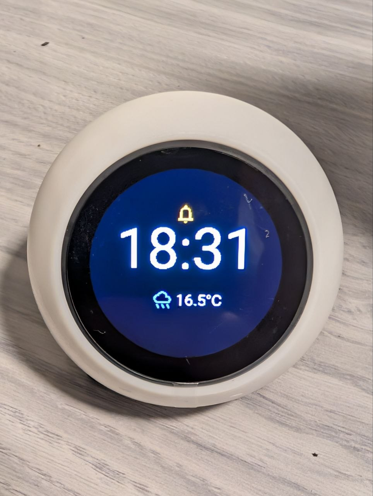

## Product Description

The **SP-ESP32-S3-1.28-BOX** (commonly sold on AliExpress as the "Xiaozhi AI Desktop Companion")
is an all-in-one circular smart display in a spherical desktop enclosure.

It features an ESP32-S3 SoC with 16MB Flash and 8MB Octal PSRAM, a 1.28" circular IPS LCD
(GC9A01A over 80MHz SPI), CST816D capacitive touch screen, Everest ES8311 I2S audio DAC
with an onboard Class-D speaker amplifier (NS4168), a rechargeable 1S LiPo battery with ADC
monitoring, and USB-C connectivity.

## Product Images



## GPIO Pinout

| GPIO | Function | Details |
| :--- | :--- | :--- |
| GPIO0 | BOOT Button | Active LOW |
| GPIO1 | Battery ADC | Voltage divider for 1S LiPo monitoring |
| GPIO4 | I2C SDA | Shared by CST816D Touch & ES8311 DAC |
| GPIO5 | SPI CS | GC9A01A Display Chip Select |
| GPIO6 | SPI MOSI | GC9A01A Display SPI Data |
| GPIO7 | SPI CLK | GC9A01A Display SPI Clock (80MHz) |
| GPIO8 | I2C SCL | Shared by CST816D Touch & ES8311 DAC |
| GPIO11 | Touch INT | CST816D Capacitive Touch Interrupt |
| GPIO12 | Touch RESET | CST816D Capacitive Touch Reset |
| GPIO15 | Display DC | GC9A01A Data / Command Control |
| GPIO16 | I2S DIN | ES8311 DAC Digital Audio Data |
| GPIO17 | I2S BCLK | ES8311 Bit Clock |
| GPIO18 | I2S LRCK | ES8311 Word Select / Left-Right Clock |
| GPIO38 | Display RESET | GC9A01A Hardware Reset |
| GPIO41 | Charge Detect | Battery charging state (active LOW) |
| GPIO42 | Backlight PWM | LEDC 1kHz PWM dimming |
| GPIO46 | Speaker Enable | NS4168 Class-D amplifier power gating |

## Basic Configuration

```yaml file=config.yaml
```

## Notes

- **Full Firmware & UI**: A complete turn-key firmware featuring LVGL 8 circular UI,
  LIFO 10-notification carousel, live weather, TTS announcements, and passive Bluetooth
  proxy is available in the [pasmimmo/SmartDisplay](https://github.com/pasmimmo/SmartDisplay) repository.
- **PSRAM**: Requires 8MB Octal PSRAM configuration for LittlevGL display rendering
  and I2S audio pipelines.
- **Audio Power Gating**: GPIO46 must be pulled HIGH during audio playback to enable the
  NS4168 speaker amplifier; pulling it LOW during standby saves ~20mA and eliminates speaker hiss.
