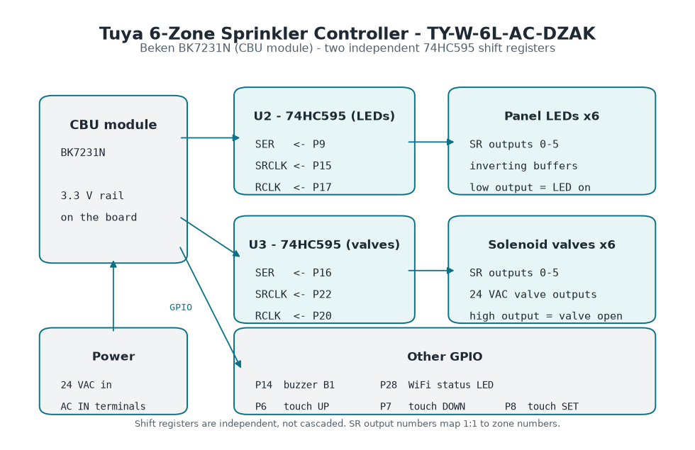

Generic Tuya 6-zone irrigation controller with Beken BK7231N (CBU module).
PCB model TY-W-6L-AC-DZAK. Uses two independent 74HC595 shift registers for
LEDs and valves, the same architecture as the 8-zone
[TY-W-8L](../tuya-8zone-sprinkler-ty-w-8l/) with two fewer zones.



## Hardware

- **SoC**: Beken BK7231N (CBU module)
- **PCB**: TY-W-6L-AC-DZAK
- **Shift registers**: 2x 74HC595 independent (not cascaded)
  - LED SR (U2): data P9, clock P15, latch P17
  - Valve SR (U3): data P16, clock P22, latch P20
- **Buzzer**: P14
- **WiFi LED**: P28
- **Touch buttons**: UP (P6), DOWN (P7), SET (P8)
- **Power**: 24 VAC

The valve and LED shift register pins were checked on a live unit: each of the
six valves opens its own zone and lights its own panel LED. The buzzer, the
WiFi LED and the touch buttons use the same pins as the 8-zone board and are
driven by the configuration below, but only the valves and LEDs were verified
on this PCB.

## Installation

The BK7231N is flashed via UART with
[ltchiptool](https://github.com/libretiny-eu/ltchiptool).

### Connections

On this board the USB-TTL adapter cannot power the chip. Feeding 3.3 V from the
adapter leaves the SoC without enough current and neither the flash read nor the
write completes. Power the board from its own 24 VAC transformer and connect
only ground and the two data lines:

```text
  USB-TTL Adapter            TY-W-6L-AC-DZAK Board
  ---------------            ---------------------
        GND  ------------------>  GND
         TX  ------------------>  RX
         RX  <------------------  TX

  24VAC Transformer          TY-W-6L-AC-DZAK Board
  -----------------          ---------------------
       24VAC ------------------>  AC IN (terminals)
```

**CRITICAL WARNING**: **NEVER connect 3.3V from the USB adapter while the board
is powered from 24VAC**. You can damage the board.

The UART pads sit on the low voltage side, but the 24 VAC adapter is plugged into
mains while you flash. Touch nothing on the board except the pads you are
probing, and unplug the transformer as soon as the write finishes.

### 1. Back up the original firmware first

Read the whole flash before writing anything. Once ESPHome is on the chip this is
the only copy of the original firmware left:

```bash
pip install ltchiptool
ltchiptool flash read bk7231n backup_original.bin
```

### 2. Compile the configuration

`config.yaml` holds the hardware definition and `sprinkler-zone-control.yaml` the
zone control application. Put both in the same file (append the second one to the
first, or pull it in with `packages:` and `!include`) and compile:

```bash
esphome compile config.yaml
```

The build leaves a UF2 image in
`.esphome/build/tuya-sprinkler-6z/.pioenvs/tuya-sprinkler-6z/firmware.uf2`.
On the ESPHome Dashboard use Install, Manual download, UF2 package instead.

### 3. Write the firmware

Enter download mode (bridge CEN/RST to GND while powering the board, then release
the bridge when the tool starts writing) and flash the compiled image:

```bash
ltchiptool flash write bk7231n firmware.uf2
```

ltchiptool only writes a compiled image, it does not compile ESPHome YAML, so pass
the UF2 file and not `config.yaml`.

## Button usage

### Navigation and zone selection

- **UP**: selects the next zone (LED blinks)
- **DOWN**: selects the previous zone (LED blinks)
- **SET**: confirms selection and activates the zone (LED stays solid)

If you don't press anything for **8 seconds**, the selection is automatically
cancelled.

### Activate a single zone

1. Press UP or DOWN until the desired zone LED blinks
2. Press SET -> the zone activates (solid LED)
3. To stop it: navigate to that zone and press SET again

### Activate all zones (full cycle)

1. Hold **UP** for **4 seconds** until all LEDs blink
2. Press SET -> all 6 zones activate in full cycle (3 confirmation beeps)

### Stop all irrigation

1. Hold **DOWN** for **4 seconds** until all LEDs blink
2. Press SET -> all zones close (3 confirmation beeps)

## Basic Configuration

Hardware definition (pinout, shift registers, valves, buzzer and panel LEDs):

```yaml file=config.yaml
```

Zone control application (selection state machine, panel buttons, LED feedback and
the `sprinkler` component). Append it to the hardware file before compiling:

```yaml file=sprinkler-zone-control.yaml
```

## Project repository

Full documentation, compiled firmware binaries, and source code available at
[github.com/gnacho/esphome-tuya-8zone-valve](https://github.com/gnacho/esphome-tuya-8zone-valve).
It holds the 8-zone
[TY-W-8L](../tuya-8zone-sprinkler-ty-w-8l/) configuration as well.
