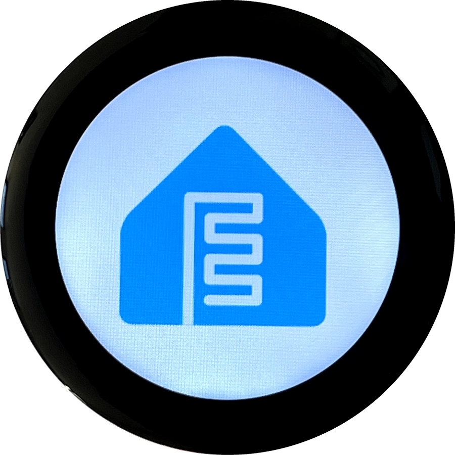

The Waveshare ESP32-S3-Touch-LCD-1.46 has a 412×412 round LCD with an SPD2010 controller connected over
quad SPI and an SPD2010 capacitive touchscreen connected over I²C.
See the [Waveshare wiki](https://www.waveshare.com/wiki/ESP32-S3-Touch-LCD-1.46B) for hardware details.

## ESPHome Support

This configuration requires ESPHome 2026.10.0 or newer.

## Pin Mapping

| Function | Pin |
| -------- | --- |
| I²C SDA | GPIO11 |
| I²C SCL | GPIO10 |
| LCD clock | GPIO40 |
| LCD data 0 | GPIO46 |
| LCD data 1 | GPIO45 |
| LCD data 2 | GPIO42 |
| LCD data 3 | GPIO41 |
| LCD chip select | GPIO21 |
| LCD reset | PCA9554 pin 1 |
| LCD backlight | GPIO5 |
| Touch interrupt | GPIO4 |

The PCA9554 GPIO expander uses I²C address `0x20`; the touchscreen uses `0x53`.

## Configuration

The hardware configuration below sets up the display, backlight, and touchscreen. Add network settings and
application logic in your own configuration.

```yaml file=config.yaml
```

The `WAVESHARE-ESP32-S3-TOUCH-LCD-1.46` display model selects GPIO21 for chip select and pin 1 of the
PCA9554 for reset. With a single PCA9554 configured, the model selects the expander automatically.
The driver manages the reset and sleep-out sequencing.

The model defaults to RGB565, SPI mode 0, 40MHz, and four-pixel draw rounding. Keep `draw_rounding: 4`
when using LVGL. Hardware mirroring is supported; axis swapping requires software rotation.

The backlight is controlled separately using a PWM output on GPIO5. The example turns it on at startup.
The touchscreen uses GPIO4 with an internal pull-up for its interrupt signal and does not need a reset pin
in this configuration. Its default calibration covers coordinates 0–411 on both axes.
Use touchscreen automations or LVGL to handle touch input and gestures.

## See Also

- [MIPI SPI Display](https://esphome.io/components/display/mipi_spi/)
- [SPD2010 Touchscreen](https://esphome.io/components/touchscreen/spd2010/)
- [PCA9554 GPIO Expander](https://esphome.io/components/pca9554/)
- [LVGL Graphics](https://esphome.io/components/lvgl/)
