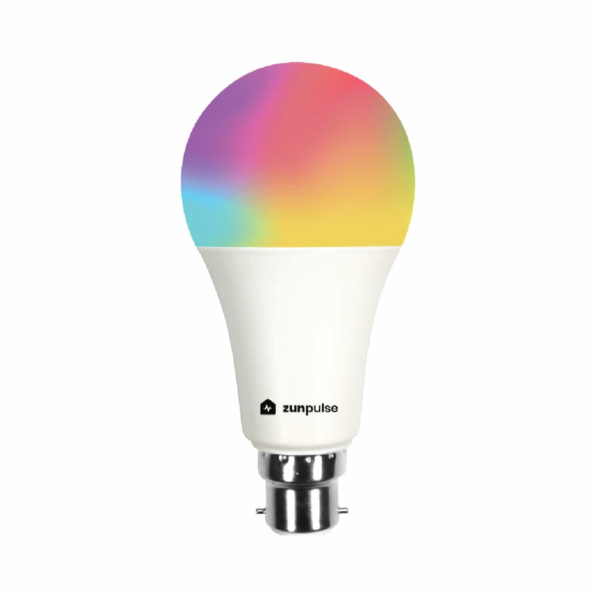

The Zunpulse 10W RGBCCT bulb is a smart bulb sold in India with red, green, blue,
cold white and warm white channels. It uses a BK7231N.

## Flashing

The bulb is not flashable over the air out of the box, so it needs soldering.

## GPIO Pinout

| Pin | Function    |
|-----|-------------|
| P26 | Red         |
| P6  | Green       |
| P24 | Blue        |
| P8  | Output cold |
| P7  | Output warm |

## Basic Configuration

```yaml file=config.yaml

```
